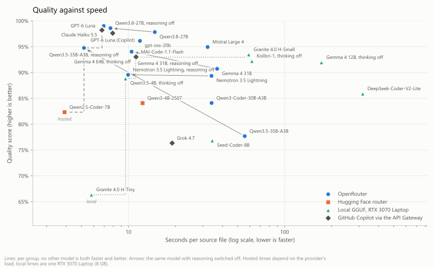
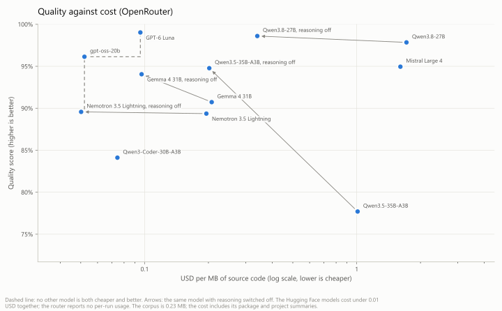
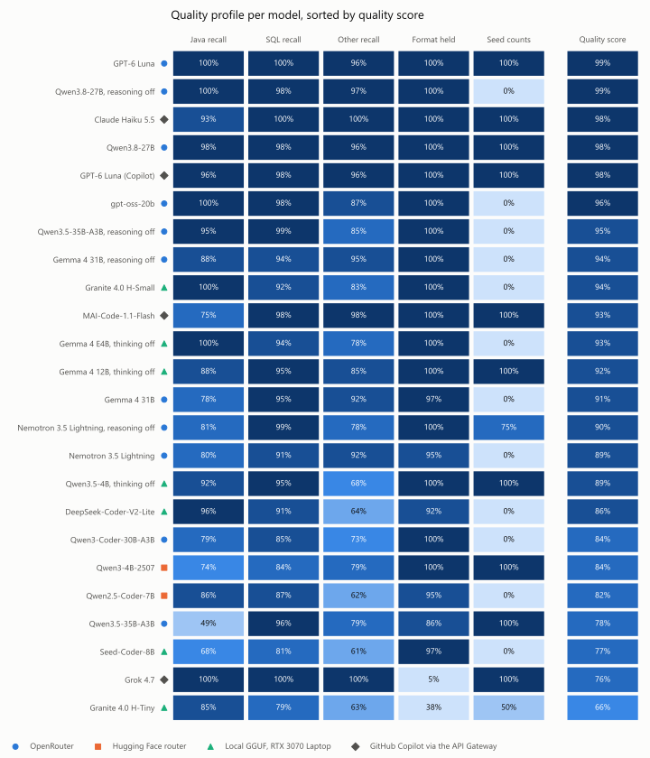

# Model card — srcmorph `.ai.md` summaries, October 2026

Which model to put behind srcmorph, measured on one fixed corpus: how much each model compacts
Java, SQL and other source files, how many of the names that matter it keeps, how many it makes up,
and how well it holds the `.ai.md` format. Hosted models (OpenRouter, Hugging Face's router and
GitHub Copilot through the [Copilot API Gateway](../copilot-api-gateway.md)) and local GGUF models
(llama.cpp on a laptop GPU) ran the same three phases with the same prompts.

The June 2026 benchmark ([COMPARISON.md](COMPARISON.md)) compared local models on Java only; the
models marked ¹ below were in it.

<!-- assessment:begin -->
## Assessment

### At a glance

The **quality score** is the mean of four shares: Java recall, SQL recall, other-file recall, and
the share of the 37 `.ai.md` that hold the format. The tables under [Results](#results) have the
parts. In the two scatter charts, a line joins the models that no other model beats on both axes
(the Pareto front). A model below the line has a better choice to its left.

<picture>
  <source media="(prefers-color-scheme: dark)" srcset="modelcard/charts/quality-vs-speed-dark.svg">
  
</picture>

<picture>
  <source media="(prefers-color-scheme: dark)" srcset="modelcard/charts/quality-vs-cost-dark.svg">
  
</picture>

<picture>
  <source media="(prefers-color-scheme: dark)" srcset="modelcard/charts/quality-profile-dark.svg">
  
</picture>

The charts are drawn by [`modelcard/plot.py`](modelcard/plot.py) from the same scores as the tables.

### Recommendations

What decides here is quality first, then speed and cost. The models in the table that ran three
times (see [Repeatability](#repeatability)) show the mean of their runs and the range; speed and
cost are from the card's run, as in the charts.

| Use | Model | Quality | Range | s/file | USD per MB of source |
|---|---|---|---|---|---|
| Hosted, best quality | **Qwen3.8-27B, reasoning off** | 98.7 % | 98.6–98.9 | 7.7 | 0.34 |
| Hosted, best per dollar | **gpt-oss-20b** | 96.8 % | 96.1–97.8 | 11.8 | 0.052 |
| Hosted, fast and cheap | **GPT-6 Luna** | 96.2 % | 93.6–99.0 | 6.9 | 0.095 |
| Hosted, fastest | **Qwen3.5-35B-A3B, reasoning off** | 95.1 % | 94.8–95.4 | 5.2 | 0.20 |
| Local, 8 GB GPU | **Gemma 4 E4B, thinking off** | 93.0 % | 92.8–93.2 | 11.1 | – |
| Local, when time does not matter | **Granite 4.0 H-Small** | 94 % | one run | 58.9 | – |
| With a GitHub Copilot plan | **Claude Haiku 5.5** | 98.2 % | one run | 6.8 | Copilot plan |

- **Qwen3.8-27B with reasoning off** is the best in every one of its three runs and the steadiest
  of the hosted models, but in the search measurement it is the weakest of the top group (84 to
  86 % against 91 to 98 %). It costs 3.5 times as much as Luna (0.34 USD per MB), so a 10 MB
  repository costs about 3.40 USD. With reasoning on it cost 18 times as much as Luna.
- **gpt-oss-20b** is level with Luna over three runs at half the price, and in the search
  measurement it is at the top (91 to 98 %). It keeps nearly every Java name, but states no seed
  counts.
- **GPT-6 Luna** had the best single run (99 %, full recall on Java and SQL, all four seed counts,
  clean format), but it was its best of three: the other two scored 96 % and 94 %. It stays the
  fastest of the top group after Qwen3.5-35B and costs about 0.10 USD per MB.
- **Qwen3.5-35B-A3B with reasoning off** is the fastest (5.2 s per file) at twice Luna's price. It
  writes the longest Java summaries (compaction 3.22).
- **Nemotron 3.5 Lightning with reasoning off** is the cheapest OpenRouter model (0.050 USD per MB).
  Its quality (90 %) is held back by Java recall (81 %). It names every member of the large files,
  but leaves names out of the small ones, for example the type name in `AiGenerationProvider`. In
  the per-file mean, a small file weighs as much as a large one.
- **Gemma 4 E4B with thinking off** is the local pick. It has full Java recall, no invented names,
  a clean format, and takes 11 s per file on an RTX 3070 Laptop.
  - **Qwen3.5-4B with thinking off** is as fast (9.6 s) and gets all four seed counts, but drops
    more names (Java 92 %, other files 68 %).
  - **Granite 4.0 H-Small** matches E4B's quality at five times the time.
  - **Kolibri-1** (Aleph Alpha's 78B mixture-of-experts with 3.5B active, October 2026,
    Apache 2.0; 92.2 %, 61.8 s per file) is the largest local model here and lands just below E4B
    at five and a half times the time. It has full Java recall, a clean format and almost no
    invented names (0.1 per 100), but SQL recall of 90 %, other-file recall of 79 % and no seed
    counts; it searches like E4B (93 % first). Its Q4_K_M weights are 46 GiB, so it runs only with
    all 50 expert layers in RAM (`cpuMoeLayers: 50`, about 45 GB of a 63 GB machine) and the rest
    on the GPU. Once the weights are in RAM it reads the prompt at 100 to 130 tokens/s and writes at
    about 25 tokens/s; the first file, while the weights were still read from a USB SSD, ran at 22
    and 4.2 tokens/s, and the 61.8 s per file include it, as every local run includes its loading.
    With 4 expert layers on the 8 GB GPU as well, VRAM filled up (8.0 of 8.2 GB) and overflowed into
    Windows' shared GPU memory: the first file then ran at 7 to 10 and 2.3 tokens/s, and a first
    attempt with 47 GB of RAM available was stopped when only 2.4 GB were left.
    Its thinking was on until srcmorph stopped sending `reasoning_effort` with thinking off, see
    finding 2.
- **Not worth their cost here:**
  - **Gemma 4 31B with reasoning off** (94.6 % over three runs, 10.5 s per file) costs as much as
    Luna (0.097 USD per MB) for no gain.
  - **Gemma 4 12B** gets the seed counts right, but takes 172 s per file: the Q4_K_M weights do not
    fit in 8 GB, so part of the model runs on the CPU.
  - **Mistral Large 4** (95.0 %, 32.1 s per file, 0.38 USD, 1.6 USD per MB) is the second most
    expensive run of the card, 17 times Luna's cost, for a lower score. Its reasoning cannot be
    switched off (see finding 1). SQL and other-file recall are full and it states all four seed
    counts, but Java recall is 82 %: it names 18 of the 44 builder methods of
    `LlamaCppJniConfig.java` and leaves the type name out of `AiGenerationProvider`. One package
    summary carries a reasoning marker, and it searches below the top group (86 % first).
- **Hugging Face router (nscale): the cheapest, not the best.** Both models together cost under
  0.01 USD at 0.01 / 0.03 USD per million input / output tokens.
  - **Qwen2.5-Coder-7B** is the fastest run of all (3.9 s per file), with Java recall at 86 %. It
    states no seed counts and writes 6 `#`–`###` headings.
  - **Qwen3-4B-Instruct-2507** gets all four seed counts, but Java recall is only 74 %.

  Neither comes close to gpt-oss-20b, which costs about one cent.
- **GitHub Copilot through the [Copilot API Gateway](../copilot-api-gateway.md)**: four runs, each
  costing nothing beyond a Copilot plan. They ran streamed (`stream: true`) through the gateway's
  VS Code extension with its limit at 30 requests a minute; at 10, Haiku and Luna (12 to 15 a
  minute) were stopped by `429` after a few files.
  - **Claude Haiku 5.5** (98.2 %, 6.8 s per file) is the third-best run of the card and on the
    hosted front: full SQL and other-file recall, all four seed counts, a clean format, Java recall
    93 %. In the search measurement it is in the top group (95 % first).
  - **GPT-6 Luna through Copilot** (97.6 %, 7.9 s per file) against the same model on OpenRouter
    (99.0 %, 6.9 s): within the 93.6 to 99.0 % Luna's three OpenRouter runs spread over, so the
    route changes nothing measurable.
  - **MAI-Code-1.1-Flash** (93.0 %, 11.2 s per file): SQL recall (98 %), all four seed counts, a
    clean format and other-file recall (98 %) are top-group. Java recall (75 %) is not: it
    describes the 88 getters and setters of `AiGenerationConfig.java` and the 37 accessors of
    `SrcMorphConfiguration.java` as groups and names 2 and 3 of them (`LlamaCppJniConfig.java`: 8 of
    44), as Luna did in one repeat run. The other nine Java files have full recall. It writes a long
    index (83 KB for the 24 file summaries; its other-file summaries are 1.75 times as long as
    their sources) and searches below the top group (91 % first, see
    [Search](#search-do-the-summaries-lead-to-the-right-file)).
  - **Grok 4.7** (76.4 %, 19.1 s per file) has full recall on every kind and all four seed counts,
    but 35 of its 37 `.ai.md` start with a sentence about the task before the `>` lead ("The user
    wants me to index the provided SQL file.", "Synthesizing a package summary from the provided
    per-file summaries."), sometimes on the lead's own line. That is its reasoning summary arriving
    as answer text through this route; it costs the format share almost entirely. Its index is the
    longest of all runs (111 KB), and it searches worst of all runs (77 % first). On
    OpenRouter (`x-ai/grok-4.7`, reasoning mandatory) xAI refused the run after 8 files with
    `403 This service is not available in your region`.
- **Avoid for this task:**
  - **Granite 4.0 H-Tiny** starts 7 summaries with "Here is the markdown summary …", wraps 13 in a
    ```` ```markdown ```` fence (34 fence lines), writes 129 `#`–`###` headings, and calls the
    `AiGenerationProvider` interface a class.
  - **Seed-Coder-8B** is too terse: compaction 9.8 at a Java recall of 68 %.
  - **DeepSeek-Coder-V2-Lite** takes 317 s per file (16B weights on an 8 GB card) and writes
    `#`–`###` headings.
  - **Qwen3-Coder-30B** describes column types (`char`, `integer`) that the seed-data file does not
    contain (17 invented per 100 on SQL) and drops names on Java (78 %).
  - **Any reasoning model with reasoning on** — see finding 1.

### Findings

1. **For this task, reasoning costs time and money and adds no quality.** Four OpenRouter models
   ran twice: first with `reasoning.effort` = `low`, then with `none`. With `low`, Nemotron 3.5
   Lightning and Qwen3.5-35B-A3B had 16 384 output tokens; every other run had the common 4096.
   Every model got at least as good with reasoning off, and every one got faster and cheaper.

   | | Quality | s/file | USD | Cut off |
   |---|---|---|---|---|
   | Qwen3.5-35B-A3B, reasoning low | 78 % | 55.6 | 0.237 | 5 (all empty) |
   | Qwen3.5-35B-A3B, reasoning off | **95 %** | **5.2** | **0.047** | 0 |
   | Nemotron 3.5 Lightning, reasoning low | 89 % | 34.1 | 0.046 | 3 (2 empty) |
   | Nemotron 3.5 Lightning, reasoning off | **90 %** | **10.0** | **0.012** | 0 |
   | Gemma 4 31B, reasoning low | 91 % | 37.0 | 0.049 | 1 |
   | Gemma 4 31B, reasoning off | **94 %** | **10.5** | **0.023** | 0 |
   | Qwen3.8-27B, reasoning low | 98 % | 14.8 | 0.403 | 0 |
   | Qwen3.8-27B, reasoning off | **99 %** | **7.7** | **0.080** | 0 |

   Reasoning tokens count against `maxOutputTokens`. Even at `low`, one test request for a
   one-line `add` method spent 799 (Qwen3.5), 419 (Nemotron), 163 (Gemma 4 31B) and 25
   (Qwen3.8) tokens on reasoning, for answers of 18 to 32 tokens. GPT-6 Luna and Qwen3-Coder spent
   none, so they were not run again. At 4096 tokens Nemotron left 15 of 24 file summaries empty. `none` turns
   reasoning off on both routes (0 reasoning tokens), and srcmorph's existing `reasoningEffort`
   setting sends it. gpt-oss-20b cannot run without reasoning: OpenRouter answers `none` with
   "Reasoning is mandatory for this endpoint", and `low` was its best setting in June. Neither can
   Mistral Large 4: Mistral answers `none` with HTTP 400 ("reasoning_effort none is not supported
   for this model"). At `low` and the common 4096 it left 9 of 37 `.ai.md` empty (0.31 USD); the
   card's run has 16 384 output tokens and none cut off.
2. **llama.cpp turns Gemma 4's thinking on by default.** With the stock chat template, Gemma 4 12B
   spent all 4096 tokens of every file on thinking and wrote no summary, at about 4.4 tokens/s.
   `chatTemplateEnableThinking: false` fixes it. With it, E4B also writes about half the tokens it
   wrote before (for example 620 instead of 1306 per file). So both Gemma 4 models and Qwen3.5-4B ran
   with thinking off. That is why Qwen3.5-4B no longer pays the "thinking tax" the June benchmark
   held against it. **Kolibri-1 reasoned with thinking off.** The local provider sent
   `reasoningEffort` (default `low`, meant for gpt-oss) to every chat template as the
   `reasoning_effort` kwarg. Kolibri's template reads it before `enable_thinking`, so with
   `chatTemplateEnableThinking: false` the first file spent all 4096 tokens on reasoning and came
   back empty. The card's run set `reasoningEffort: none`, a value the template accepts. srcmorph
   now sends thinking off the way llama.cpp's server handles it, `enable_thinking` `false` and no
   `reasoning_effort`, whether `chatTemplateEnableThinking: false` or `reasoningEffort: none` asks
   for it. Kolibri's template renders the same prompt for that as for the run's kwargs (checked by
   rendering it with Jinja), so the run stands for the fixed provider.
3. **srcmorph keeps a cut-off summary as if it were done.** A cut-off generation produces only a WARN
   (`Generated text for … was cut off …`), and the truncated `.ai.md` counts as up to date. An
   incremental run regenerates it only after the source changes. An empty body is written as well
   (`AI provider returned empty body …`), but the next run retries it. For the OpenAI-compatible
   provider the cut-off warning is logged under the `LlamaCppJniProviderSupport` logger, which points
   at the wrong backend. Both are in [`TODO.md`](../../TODO.md).
4. **Format discipline depends on the model, not on the prompt.** All prompts are the v1 prompts, and
   17 of 26 runs follow them without a slip. The June code-fence regression of DeepSeek and
   Seed-Coder came with prompt v2 and does not show up with v1. Granite H-Tiny, which was clean in
   June, is not clean here.

### Repeatability

Every other number on this card comes from one run at temperature 0.2. The six top hosted
configurations ran twice more, and Gemma 4 E4B ran three more times on the same GPU: once with the
card's seed 42 and with seeds 43 and 44. The outputs are under [`repeat-2026-10/`](repeat-2026-10/),
and [`modelcard/repeat.py`](modelcard/repeat.py) scores them with the card's metrics into
[`modelcard/scores/repeat.json`](modelcard/scores/repeat.json).

| | Quality: card / run 2 / run 3 | Spread (points) | s/file | USD |
|---|---|---|---|---|
| Qwen3.8-27B, reasoning off | 98.6 / 98.7 / 98.9 % | 0.3 | 7.7 / 7.8 / 10.1 | 0.080 / 0.079 / 0.074 |
| gpt-oss-20b | 96.1 / 97.8 / 96.6 % | 1.7 | 11.8 / 11.1 / 8.7 | 0.012 / 0.013 / 0.009 |
| GPT-6 Luna | 99.0 / 96.0 / 93.6 % | 5.4 | 6.9 / 7.8 / 10.1 | 0.022 / – ² / 0.020 |
| Qwen3.5-35B-A3B, reasoning off | 94.8 / 95.4 / 95.2 % | 0.6 | 5.2 / 5.3 / 6.5 | 0.047 / 0.052 / 0.051 |
| Gemma 4 31B, reasoning off | 94.1 / 94.2 / 95.5 % | 1.5 | 10.5 / 15.0 / 16.1 | 0.023 / 0.024 / 0.030 |
| Nemotron 3.5 Lightning, reasoning off | 89.6 / 92.1 / 91.0 % | 2.6 | 10.0 / 3.2 / 18.7 | 0.012 / 0.011 / 0.012 |
| Gemma 4 E4B, local: seed 42 / 42 / 43 / 44 | 93.0 / 93.0 / 93.2 / 92.8 % | 0.4 | 11.1 / 11.4 / 12.7 / 12.5 | – |

² The account's usage during Luna's second run also covered the first calls of the search
measurement below (about 0.02 USD), so that run's own cost is not known.

- **A local run with a fixed seed repeats exactly.** Seed 42 reproduced all 24 file summaries of
  the card's run byte for byte. Seeds 43 and 44 changed every file, but quality by at most
  0.4 points.
- **Hosted runs move by 0.3 to 5.4 points.** A difference of one to three points between two
  single runs of the top group is within that, so the card's first ranking (Luna 99.0 %, then
  Qwen3.8 98.6 %, then gpt-oss 96.1 %) did not hold. Qwen3.8-27B was best in every run.
- **Luna's drops come from two files.** In runs 2 and 3, `rotate_backups.sh` keeps 2 of its 5
  expected names. In run 3 Luna describes the 88 getters and setters of `AiGenerationConfig.java`
  as groups and names 3 of them, which costs 9 points of Java recall: the per-file mean weighs
  that one file as much as any other. Whether grouping hurts a reader is what the search
  measurement below checks.
- **Hosted speed depends on where OpenRouter routes the request.** Nemotron took 3.2 to 18.7 s per
  file over three runs, Gemma 4 31B 10.5 to 16.1 s. Cost moves less: at most a third.

### Search: do the summaries lead to the right file?

Recall counts names; it does not show whether a summary leads a reader to the right file, which is
what an `.ai.md` is for. [`modelcard/search-questions.json`](modelcard/search-questions.json) has 43
developer questions, each with the corpus file (or the two or three files) that answers it, for
example "Where is it prevented that an API key goes out in cleartext over plain HTTP to a host that
is not local?". They were written from the sources before any summary was read, and most avoid the
answer file's identifiers. [`modelcard/search.py`](modelcard/search.py) searches the 24 file
summaries of each run two ways:

- **Reader:** one call per question to Mistral Small 3.2 24B (not one of the tested models), which
  sees every summary under its path, as an agent browsing the index would, and names the three most
  likely files.
- **BM25** over the summary bodies, with identifiers split into words.

Two baselines go through the same retrievers: the paths alone, and the source files themselves.
hit@1 counts a question as found when an answer file comes first, hit@3 when it is among the first
three. One question is 2.3 points. The reader calls cost 1.24 USD for the card's 22 contexts,
0.81 USD for the repeat runs, 0.28 USD for the four Copilot runs and 0.15 USD for Mistral Large 4
and Kolibri-1, which were added later. Results are in
[`modelcard/scores/search.json`](modelcard/scores/search.json), and per question in
[`search.tsv`](modelcard/scores/search.tsv); those of the repeat runs next to their outputs.

| | Reader hit@1 | Reader hit@3 | MRR | BM25 hit@1 | BM25 hit@3 |
|---|---|---|---|---|---|
| gpt-oss-20b | 98 % | 98 % | 0.98 | 86 % | 95 % |
| Gemma 4 31B, reasoning off | 95 % | 100 % | 0.98 | 81 % | 98 % |
| Granite 4.0 H-Small | 95 % | 100 % | 0.98 | 81 % | 93 % |
| Qwen3-4B-Instruct-2507 | 95 % | 100 % | 0.98 | 81 % | 98 % |
| Gemma 4 12B, thinking off | 95 % | 100 % | 0.97 | 86 % | 93 % |
| Claude Haiku 5.5 (Copilot) | 95 % | 100 % | 0.97 | 79 % | 100 % |
| Qwen3.5-4B, thinking off | 95 % | 100 % | 0.97 | 84 % | 100 % |
| Gemma 4 31B | 93 % | 100 % | 0.96 | 86 % | 95 % |
| Gemma 4 E4B, thinking off | 93 % | 100 % | 0.96 | 81 % | 100 % |
| Kolibri-1, thinking off | 93 % | 100 % | 0.96 | 79 % | 100 % |
| GPT-6 Luna | 93 % | 100 % | 0.96 | 77 % | 98 % |
| Nemotron 3.5 Lightning, reasoning off | 93 % | 100 % | 0.96 | 86 % | 98 % |
| Qwen3.8-27B | 95 % | 98 % | 0.96 | 81 % | 100 % |
| Qwen2.5-Coder-7B | 93 % | 100 % | 0.96 | 74 % | 95 % |
| Nemotron 3.5 Lightning | 93 % | 98 % | 0.95 | 77 % | 91 % |
| DeepSeek-Coder-V2-Lite | 93 % | 98 % | 0.95 | 77 % | 98 % |
| Qwen3.5-35B-A3B, reasoning off | 93 % | 98 % | 0.95 | 86 % | 98 % |
| Qwen3-Coder-30B-A3B | 91 % | 98 % | 0.94 | 84 % | 95 % |
| Seed-Coder-8B | 91 % | 95 % | 0.93 | 77 % | 93 % |
| MAI-Code-1.1-Flash | 91 % | 95 % | 0.93 | 81 % | 93 % |
| GPT-6 Luna (Copilot) | 88 % | 98 % | 0.93 | 79 % | 98 % |
| Qwen3.8-27B, reasoning off | 86 % | 98 % | 0.92 | 84 % | 98 % |
| Mistral Large 4 | 86 % | 98 % | 0.92 | 84 % | 95 % |
| Granite 4.0 H-Tiny | 81 % | 91 % | 0.86 | 74 % | 88 % |
| Grok 4.7 (Copilot) | 77 % | 93 % | 0.85 | 81 % | 95 % |
| Qwen3.5-35B-A3B | 79 % | 88 % | 0.83 | 67 % | 74 % |
| *Baseline: paths only* | 74 % | 91 % | 0.82 | – | – |
| *Baseline: source files* | 72 % | 79 % | 0.76 | 84 % | 98 % |

- **The summaries help a model find the right file.** With any of 23 of the 26 runs the reader
  finds 86 to 98 % of the answers first. With the paths alone it finds 74 %, and with the whole
  source (about 65 000 tokens instead of about 16 000) only 72 %.
- **Keyword search gains nothing from them.** BM25 over the summaries (67 to 86 % first) is not
  better than BM25 over the source (84 %): the source contains the same words and more.
- **What hurts search is a missing or broken summary, not a missing name.** The three runs that fall
  behind are Qwen3.5-35B-A3B with reasoning low (5 empty Java summaries), Granite H-Tiny (its
  format slips) and Grok 4.7 (a sentence about the task before almost every lead). Seed-Coder-8B, at a Java recall of 68 %, still finds 91 %.
- **Among the other 23 runs the order is noise.** The reader misreads one to three questions per
  run even when the summary is clear. For example, with Qwen3.8-27B's summaries (reasoning off) it
  ranks `AiConditionEvaluator.java` first for "Where is every checkout and return written to an
  audit trail?", which is answered by `03_routines.sql`. Over the repeat runs, the six hosted
  configurations and E4B moved by 2 to 7 points (one to three questions): gpt-oss-20b 91 to 98 %,
  GPT-6 Luna 91 to 93 %, Gemma 4 31B with reasoning off 95 to 98 %, Gemma 4 E4B 93 to 95 %.
- **One exception holds in every run: Qwen3.8-27B with reasoning off searches worst of the top
  group** (86, 84 and 86 %), although it has the best quality score. Its summaries are not wrong:
  for both questions about oversized files its `AiOversizeStrategy.java` summary describes the
  four strategies and the `<onOversize>` token, and the reader still ranks
  `AiConditionEvaluator.java` first in all three runs. Its summaries are among the longest (about
  71 KB for the 24 files, gpt-oss-20b writes 51 to 58 KB), and over the 32 scored runs without
  empty or broken summaries a longer index tends to search worse with this reader (correlation
  −0.46). Length does not explain it alone, though: the same model with reasoning low writes 74 KB
  and finds 95 %. MAI-Code-1.1-Flash, added later, writes the longest index (83 KB) and misses the
  two questions about blocked members and the audit trail, although its `03_routines.sql` summary
  names `is_blocked` and `loan_audit`.
- One answer was corrected after the first scoring: "Can a single model definition use a different
  backend than the one the run names?" now also accepts `AiGenerationConfig.java`, whose
  `getProvider()` documents exactly that. Before the correction 18 of 20 runs missed it.

### Compared with June 2026

June measured local models on CPU, Java only. This round adds SQL and other files, a GPU, and hosted
models.
- **gpt-oss-20b** stays the most faithful of the June set (Java recall 99.9 %).
- **Qwen3-Coder-30B-A3B**, June's throughput alternative, falls behind on recall and on invented
  names.
- **Granite H-Tiny**, June's high-throughput choice, fails on format.
- **Qwen3-4B-Instruct-2507**, June's budget pick over Qwen3.5-4B, now falls behind it: Java recall
  74 % against 92 %. Qwen3-4B ran hosted here, Qwen3.5-4B locally at Q4, and Qwen3.5-4B had thinking
  off.
- **Gemma 4** was not in June. With thinking off, E4B is the best local model on this hardware.
- **June's verdict on reasoning holds:** reasoning was a throughput tax with no quality gain there,
  and here it is a tax in both money and time.

### What to measure next

Ordered by what would change a decision:

1. **Correctness of what is stated.** Recall and invented names are proxies; a summary can name
   every method and still describe one wrongly. A hand check of about five files per top model,
   each statement marked right or wrong against the source, or a judge model with that check
   sampled by hand.
2. **Large files.** The largest file here is 51 KB. srcmorph's oversize path (map-reduce over
   chunks) has been timed but not judged for quality. One 300 KB to 1 MB file per kind through the
   top models would show where quality drops and what it costs.
3. **Token usage per call.** srcmorph does not log the usage the API returns. With it, cost and
   speed could be explained per file (input against output against reasoning), and the Hugging
   Face runs could be priced exactly.
4. **Local options this card does not cover:** Gemma 4 E4B at Q8_0 against Q4_K_M (it fits in
   8 GB either way), and the prompt v2 of June against v1 on the winners.
5. **A harder search test.** With 24 files the reader finds nearly every answer from any decent
   summary, so the search measurement separates only broken summaries from working ones. A larger
   corpus with many files of the same kind (a whole module, say 200 files) and questions that need
   a detail of one of several similar files would show whether the better summaries also search
   better.
<!-- assessment:end -->

## Results

<!-- generated:begin -->
### Run overview

| Model | Backend | Files | Time (min) | s/file | Cost (USD) | Cut off |
|---|---|---|---|---|---|---|
| GPT-6 Luna | OpenRouter | 37 | 4.4 | 6.9 | 0.0224 | 0 |
| Gemma 4 31B it | OpenRouter | 37 | 25.0 | 37.0 | 0.0486 | 1 (`java/provider/AiCompletionParser.java`) |
| Gemma 4 31B it (reasoning off) | OpenRouter | 37 | 6.1 | 10.5 | 0.0227 | 0 |
| Nemotron 3.5 Lightning 30B-A3B | OpenRouter | 37 | 19.7 | 34.1 | 0.0459 | 3 (`java/config/SrcMorphConfiguration.java`, `java/provider/LlamaCppJniAiGenerationProvider.java`, `java/provider/LlamaCppJniConfig.java`) |
| Nemotron 3.5 Lightning 30B-A3B (reasoning off) | OpenRouter | 37 | 5.2 | 10.0 | 0.0118 | 0 |
| Qwen3-Coder-30B-A3B-Instruct ¹ | OpenRouter | 37 | 17.7 | 34.1 | 0.0175 | 0 |
| Qwen3.5-35B-A3B | OpenRouter | 37 | 28.5 | 55.6 | 0.2371 | 5 (`java/config/AiFactExtractor.java`, `java/config/AiGenerationConfig.java`, `java/config/AiOversizeStrategy.java`, `java/config/SrcMorphConfiguration.java`, `java/provider/AiCompletionParser.java`) |
| Qwen3.5-35B-A3B (reasoning off) | OpenRouter | 37 | 2.9 | 5.2 | 0.0473 | 0 |
| Qwen3.8-27B | OpenRouter | 37 | 8.7 | 14.8 | 0.4030 | 0 |
| Qwen3.8-27B (reasoning off) | OpenRouter | 37 | 5.4 | 7.7 | 0.0798 | 0 |
| gpt-oss-20b ¹ | OpenRouter | 37 | 7.1 | 11.8 | 0.0122 | 0 |
| Mistral Large 4 | OpenRouter | 37 | 20.1 | 32.1 | 0.3772 | 0 |
| Qwen3-4B-Instruct-2507 ¹ | HF / nscale | 37 | 6.5 | 12.3 | see text | 0 |
| Qwen2.5-Coder-7B-Instruct ¹ | HF / nscale | 37 | 2.4 | 3.9 | see text | 0 |
| MAI-Code-1.1-Flash | Copilot API Gateway | 37 | 6.3 | 11.2 | Copilot plan | 0 |
| Claude Haiku 5.5 | Copilot API Gateway | 37 | 4.0 | 6.8 | Copilot plan | 0 |
| GPT-6 Luna (Copilot) | Copilot API Gateway | 37 | 4.0 | 7.9 | Copilot plan | 0 |
| Grok 4.7 | Copilot API Gateway | 37 | 10.6 | 19.1 | Copilot plan | 0 |
| Gemma 4 12B it (Q4_K_M, thinking off) | local GGUF (RTX 3070) | 37 | 95.2 | 172.3 | 0 (local) | 0 |
| Gemma 4 E4B it (Q4_K_M, thinking off) | local GGUF (RTX 3070) | 37 | 6.3 | 11.1 | 0 (local) | 0 |
| Qwen3.5-4B (Q4_K_M, thinking off) ¹ | local GGUF (RTX 3070) | 37 | 6.1 | 9.6 | 0 (local) | 0 |
| Granite 4.0 H-Tiny (Q4_K_M) ¹ | local GGUF (RTX 3070) | 37 | 3.3 | 5.8 | 0 (local) | 1 (`sql/library/05_seed_data.sql`) |
| Granite 4.0 H-Small (UD-Q4_K_XL) ¹ | local GGUF (RTX 3070) | 37 | 34.9 | 58.9 | 0 (local) | 0 |
| Seed-Coder-8B-Instruct (Q4_K_M) ¹ | local GGUF (RTX 3070) | 37 | 19.6 | 34.4 | 0 (local) | 0 |
| Kolibri-1 (Q4_K_M, thinking off) | local GGUF (RTX 3070) | 37 | 34.0 | 61.8 | 0 (local) | 0 |
| DeepSeek-Coder-V2-Lite-Instruct (Q4_K_M) ¹ | local GGUF (RTX 3070) | 37 | 164.9 | 316.6 | 0 (local) | 1 (`java/config/AiGenerationConfig.java`) |

### Compaction and faithfulness per file kind

| Model | Java comp. | Java recall | SQL comp. | SQL recall | Seed counts | Other comp. | Other recall | Invented /100 |
|---|---|---|---|---|---|---|---|---|
| GPT-6 Luna | 4.09 | 100% | 4.29 | 100% | 4/4 | 0.82 | 96% | 0.4 |
| Gemma 4 31B it | 4.79 | 78% | 5.85 | 95% | 0/4 | 0.88 | 92% | 0.5 |
| Gemma 4 31B it (reasoning off) | 5.00 | 88% | 5.86 | 94% | 0/4 | 0.89 | 95% | 0.6 |
| Nemotron 3.5 Lightning 30B-A3B | 3.86 | 80% | 4.52 | 91% | 0/4 | 0.84 | 92% | 0.8 |
| Nemotron 3.5 Lightning 30B-A3B (reasoning off) | 3.72 | 81% | 3.95 | 99% | 3/4 | 0.77 | 78% | 0.8 |
| Qwen3-Coder-30B-A3B-Instruct ¹ | 5.05 | 78% | 5.45 | 85% | 0/4 | 0.91 | 73% | 5.8 |
| Qwen3.5-35B-A3B | 4.66 | 49% | 5.06 | 96% | 4/4 | 0.96 | 79% | 0.6 |
| Qwen3.5-35B-A3B (reasoning off) | 3.22 | 96% | 4.28 | 99% | 0/4 | 0.75 | 85% | 0.5 |
| Qwen3.8-27B | 3.49 | 98% | 4.18 | 98% | 4/4 | 0.69 | 96% | 1.6 |
| Qwen3.8-27B (reasoning off) | 3.69 | 100% | 4.31 | 98% | 0/4 | 0.66 | 97% | 1.0 |
| gpt-oss-20b ¹ | 5.25 | 100% | 5.45 | 98% | 0/4 | 0.94 | 87% | 0.8 |
| Mistral Large 4 | 3.42 | 82% | 3.43 | 100% | 4/4 | 0.67 | 100% | 1.1 |
| Qwen3-4B-Instruct-2507 ¹ | 4.72 | 74% | 4.49 | 84% | 4/4 | 0.91 | 79% | 1.0 |
| Qwen2.5-Coder-7B-Instruct ¹ | 4.23 | 86% | 5.57 | 87% | 0/4 | 0.99 | 62% | 0.8 |
| MAI-Code-1.1-Flash | 4.06 | 75% | 2.58 | 98% | 4/4 | 0.57 | 98% | 1.2 |
| Claude Haiku 5.5 | 3.76 | 93% | 3.76 | 100% | 4/4 | 0.61 | 100% | 1.7 |
| GPT-6 Luna (Copilot) | 5.09 | 96% | 5.20 | 98% | 4/4 | 0.94 | 96% | 0.7 |
| Grok 4.7 | 2.18 | 100% | 3.06 | 100% | 4/4 | 0.64 | 100% | 0.8 |
| Gemma 4 12B it (Q4_K_M, thinking off) | 4.22 | 88% | 5.72 | 95% | 4/4 | 0.90 | 85% | 0.2 |
| Gemma 4 E4B it (Q4_K_M, thinking off) | 4.08 | 100% | 5.36 | 94% | 0/4 | 0.91 | 78% | 0.0 |
| Qwen3.5-4B (Q4_K_M, thinking off) ¹ | 4.32 | 92% | 4.42 | 95% | 4/4 | 0.91 | 68% | 1.1 |
| Granite 4.0 H-Tiny (Q4_K_M) ¹ | 6.26 | 85% | 2.91 | 79% | 2/4 | 1.19 | 63% | 1.2 |
| Granite 4.0 H-Small (UD-Q4_K_XL) ¹ | 4.93 | 100% | 5.08 | 92% | 0/4 | 0.91 | 83% | 0.5 |
| Seed-Coder-8B-Instruct (Q4_K_M) ¹ | 9.83 | 68% | 6.63 | 81% | 0/4 | 1.40 | 61% | 0.6 |
| Kolibri-1 (Q4_K_M, thinking off) | 4.44 | 100% | 5.16 | 90% | 0/4 | 1.00 | 79% | 0.1 |
| DeepSeek-Coder-V2-Lite-Instruct (Q4_K_M) ¹ | 3.60 | 96% | 4.29 | 91% | 0/4 | 0.98 | 64% | 0.5 |

### Format discipline (all 37 `.ai.md` per model)

| Model | No lead | `###` headings | Code fences | Reasoning leaks | Empty |
|---|---|---|---|---|---|
| GPT-6 Luna | 0 | 0 | 0 | 0 | 0 |
| Gemma 4 31B it | 1 | 0 | 0 | 0 | 0 |
| Gemma 4 31B it (reasoning off) | 0 | 0 | 0 | 0 | 0 |
| Nemotron 3.5 Lightning 30B-A3B | 0 | 0 | 0 | 0 | 2 |
| Nemotron 3.5 Lightning 30B-A3B (reasoning off) | 0 | 0 | 0 | 0 | 0 |
| Qwen3-Coder-30B-A3B-Instruct ¹ | 0 | 0 | 0 | 0 | 0 |
| Qwen3.5-35B-A3B | 0 | 0 | 0 | 0 | 5 |
| Qwen3.5-35B-A3B (reasoning off) | 0 | 0 | 0 | 0 | 0 |
| Qwen3.8-27B | 0 | 0 | 0 | 0 | 0 |
| Qwen3.8-27B (reasoning off) | 0 | 0 | 0 | 0 | 0 |
| gpt-oss-20b ¹ | 0 | 0 | 0 | 0 | 0 |
| Mistral Large 4 | 0 | 0 | 0 | 1 | 0 |
| Qwen3-4B-Instruct-2507 ¹ | 0 | 0 | 0 | 0 | 0 |
| Qwen2.5-Coder-7B-Instruct ¹ | 0 | 6 | 0 | 0 | 0 |
| MAI-Code-1.1-Flash | 0 | 0 | 0 | 0 | 0 |
| Claude Haiku 5.5 | 0 | 0 | 0 | 0 | 0 |
| GPT-6 Luna (Copilot) | 0 | 0 | 0 | 0 | 0 |
| Grok 4.7 | 35 | 0 | 0 | 0 | 0 |
| Gemma 4 12B it (Q4_K_M, thinking off) | 0 | 0 | 0 | 0 | 0 |
| Gemma 4 E4B it (Q4_K_M, thinking off) | 0 | 0 | 0 | 0 | 0 |
| Qwen3.5-4B (Q4_K_M, thinking off) ¹ | 0 | 0 | 0 | 0 | 0 |
| Granite 4.0 H-Tiny (Q4_K_M) ¹ | 20 | 129 | 34 | 0 | 0 |
| Granite 4.0 H-Small (UD-Q4_K_XL) ¹ | 0 | 0 | 0 | 0 | 0 |
| Seed-Coder-8B-Instruct (Q4_K_M) ¹ | 0 | 1 | 0 | 0 | 0 |
| Kolibri-1 (Q4_K_M, thinking off) | 0 | 0 | 0 | 0 | 0 |
| DeepSeek-Coder-V2-Lite-Instruct (Q4_K_M) ¹ | 0 | 18 | 0 | 0 | 0 |

¹ also in the June 2026 benchmark ([COMPARISON.md](COMPARISON.md)).
<!-- generated:end -->

## Method

### Corpus (24 source files, 37 `.ai.md` per model)

| Kind | Files | Bytes | What it is |
|---|---|---|---|
| Java | 12 | 159 594 | `config/` and `provider/` of srcmorph itself, taken with `git archive` from `1e056c2` (`main` after PR #253) |
| SQL | 7 | 66 780 | [`corpus/sql/`](corpus/sql/): a PostgreSQL library schema in five files (tables + constraints, views + a materialized view, functions/procedure/trigger, a v2 migration, 54 KB of generated seed data), one MySQL file with a stored procedure, one T-SQL file with `MERGE` and `TRY/CATCH` |
| Other | 5 | 8 231 | [`corpus/other/`](corpus/other/): a C ring buffer (`.h` + `.c`), an OpenCL histogram kernel, a Python report script, a Bash backup-rotation script |

All fixtures are written for this benchmark (Apache-2.0); the seed data is produced by
[`tools/generate-seed-sql.py`](tools/generate-seed-sql.py) (deterministic, fixed seed) and holds
15 authors, 110 books, 50 members and 150 loans, so a summary can be checked for the exact counts.

### Phases and prompts

Every model ran the three CLI phases `GenerateFileIndex`, `AggregatePackages` and
`AggregateProject` with `force` on. File prompts are routed by extension: `.java` →
`file-body-java`, `.sql` → `file-body-sql`, everything else → `file-body-fallback`; the package
and project phases use `package-body` and `project-body`. These are the v1 prompts of the
plugin's self-test profile, copied into [`modelcard/prompts.json`](modelcard/prompts.json).

### Settings

| | OpenRouter | Copilot API Gateway | Local (llama.cpp JNI) |
|---|---|---|---|
| Context | 131 072 | 120 000 (the model's `max_input_tokens` is 127 790) | 32 768 |
| `maxOutputTokens` | 4096 (16 384 for the reasoning-low runs of Nemotron 3.5 Lightning and Qwen3.5-35B-A3B and for Mistral Large 4, see finding 1) | 4096 (the gateway does not pass it on) | 4096 |
| Temperature | 0.2 | 0.2 | 0.2 (seed 42) |
| Reasoning | `reasoning.effort` = `low` where the model has it; `none` for the runs marked "reasoning off" | not set | thinking off where the template has a switch (Gemma 4, Qwen3.5, Kolibri-1; Kolibri-1 also `reasoningEffort: none`, which renders the same prompt, see finding 2) |
| Weights | whatever precision the OpenRouter route serves (not stated per request) | whatever GitHub Copilot serves | Q4_K_M (Granite H-Small UD-Q4_K_XL) |
| Hardware | — | — (the gateway runs in VS Code on the benchmark machine, `stream: true`) | RTX 3070 Laptop (8 GB), 63 GB RAM, CUDA 13 natives of `net.ladenthin:llama` 6.0.0, layers auto-fitted (Kolibri-1: every layer on the GPU except the 50 expert layers, `cpuMoeLayers`), 8 CPU threads |

Everything is in [`modelcard/models.json`](modelcard/models.json); a model's `note` says why it
deviates from the common settings.

### Metrics ([`modelcard/score.py`](modelcard/score.py))

- **Compaction** — source bytes / `.ai.md` body bytes, per file kind, over the files that got a
  body. Higher is shorter. Below 1 means the summary is longer than the file.
- **Recall** — per file the share of expected names the body mentions as a whole word, averaged
  over the files of a kind. For Java the expected names are the public type and its
  public/protected methods, read from the source; for SQL and the other files they are listed in
  [`modelcard/facts.json`](modelcard/facts.json) (tables, columns, constraints, routines,
  functions, constants). An empty body scores 0.
- **Invented** — backticked identifiers in the body that occur nowhere in the source, per 100
  backticked identifiers (case-insensitive for SQL). A proxy for made-up names, not a fact check.
- **Seed counts** — how many of the four row counts of `05_seed_data.sql` the body states exactly.
- **Format** — bodies without the `>` lead line, `#`–`###` headings (the prompts allow `####` and
  below), code fences, leaked reasoning markers, empty or missing bodies.
- **Quality score** — the mean of Java recall, SQL recall, other-file recall and the share of the
  37 `.ai.md` that hold the format: a body, the `>` lead, no `#`–`###` heading, no code fence and
  no reasoning leak. The four parts weigh the same. The seed counts and invented names are shown,
  but are not part of the score. Computed by [`modelcard/plot.py`](modelcard/plot.py).
- **Cut off** — files whose generation hit `maxOutputTokens` (the provider's warning in the log).
- **Speed** — seconds of the `GenerateFileIndex` phase per source file (24 files).
- **Cost** — the difference of OpenRouter's `total_usage` before and after a model's run. The
  charts divide it by the corpus's 0.23 MB of source code, which includes the package and project
  summaries the run also writes. Hugging
  Face's router reports no per-run usage. The "see text" entries are priced at nscale's list price
  under Recommendations. A Copilot run is covered by the Copilot plan and has no per-run price.

[`modelcard/run.py`](modelcard/run.py) runs a model, [`modelcard/score.py`](modelcard/score.py)
writes [`scores/files.tsv`](modelcard/scores/files.tsv) (one row per model and file) and
[`scores/summary.json`](modelcard/scores/summary.json), and
[`modelcard/report.py`](modelcard/report.py) renders the tables above from them, and
[`modelcard/plot.py`](modelcard/plot.py) draws the charts into
[`modelcard/charts/`](modelcard/charts/), each one for a light and a dark page. The `.ai.md`
trees are in [`outputs-2026-10/`](outputs-2026-10/), one directory per model.
[`modelcard/repeat.py`](modelcard/repeat.py) scores the repeat runs under
[`repeat-2026-10/`](repeat-2026-10/) (made with `run.py --out <run>/out --meta <run>/meta`, and
`--seed` for the local ones), and [`modelcard/search.py`](modelcard/search.py) runs the search
measurement.

### Caveats

- **One run per model** at temperature 0.2, except the seven configurations under
  [Repeatability](#repeatability): hosted runs moved by up to 5.4 points, so differences of a few
  points are noise.
- **Hosted and local weights differ.** An OpenRouter route serves the weights its provider
  chose (often BF16 or FP8); the local models are 4-bit. A hosted model and a local one are not comparable on quality alone.
- **Recall and invented names are proxies.** A summary that names every method can still describe
  one wrongly, and one that paraphrases instead of naming scores lower than it deserves. The
  outputs are there to read.
- **The SQL and other fixtures are small** (1–3 KB, the seed data aside). Compaction on files that
  small mostly measures how much a model writes regardless of input; the Java files (up to 51 KB)
  say more about compaction.
- **Four runs went through GitHub Copilot**, not OpenRouter: MAI-Code-1.1-Flash is on neither
  OpenRouter nor Hugging Face's router (Microsoft serves it on Azure AI Foundry and GitHub
  Copilot), Grok 4.7 was refused on OpenRouter (see Recommendations), and Claude Haiku 5.5 and GPT-6
  Luna show what the route does. The gateway extension sits between srcmorph and Copilot, so the
  times include VS Code's language-model API, and the answers are what that API passes on (Grok's
  reasoning summary included).

### Earlier SQL measurements

SQL had been run before, in the oversize work (map-reduce over chunks, commits `2145a4f`,
`94deb32`, `8b952f5`, `edf98f2`, `a10b13c`, `799c8fe`, `16e0b7a`), with Granite 4.0 H-Micro and
H-1B only and measuring speed and robustness, not quality: a 1 MB SQL file took 16:39 min with
H-Micro and 8:27 min with H-1B on CPU (about 40 s on a GPU), and a 10 MB dump went through 278
chunks with a hierarchical reduce at about 2.8 characters per token. The exact whole-file counts
(`INSERT` rows, tables, views) come from the fact extractor there, not from the model; this
benchmark asks the model itself for the seed-data counts.
