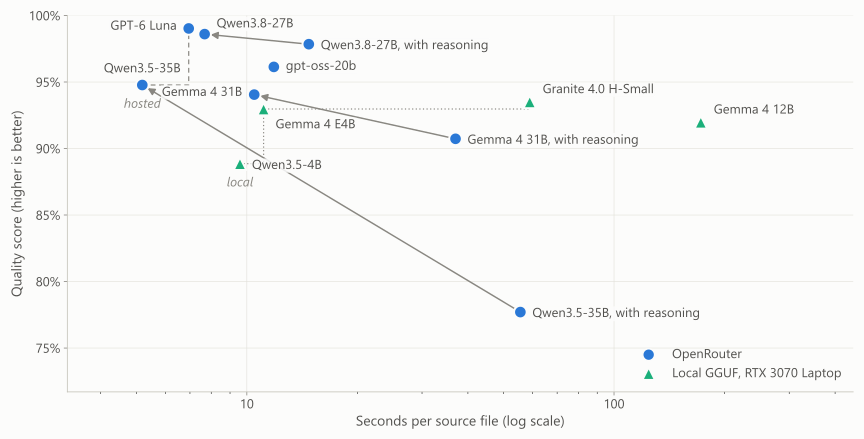
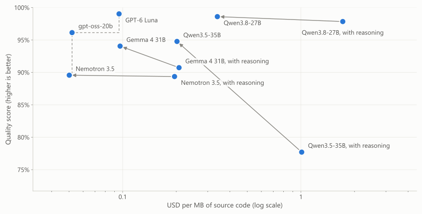
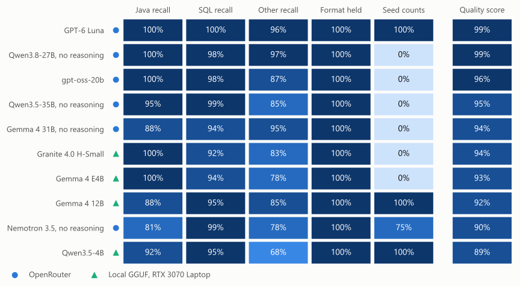

<!--
SPDX-FileCopyrightText: 2026 Bernard Ladenthin <bernard.ladenthin@gmail.com>
SPDX-License-Identifier: Apache-2.0

Render as Marp with HTML enabled. Model-card charts are referenced from the repository.
-->
<svg xmlns="http://www.w3.org/2000/svg" width="1600" height="900" viewBox="0 0 1600 900"><defs><marker id="a" markerWidth="7" markerHeight="7" refX="6" refY="3" orient="auto" markerUnits="strokeWidth"><path d="M0 0 L0 6 L6 3 z" fill="#002db7"/></marker></defs><rect x="0" y="0" width="1600" height="900" rx="0" fill="#eaf0f9" stroke="#eaf0f9" stroke-width="2"/><text x="60" y="62" fill="#081f49" font-size="42" font-weight="700" text-anchor="start" font-family="Arial, sans-serif">One ecosystem: native inference to agent context</text><text x="62" y="98" fill="#4b6385" font-size="20" font-weight="400" text-anchor="start" font-family="Arial, sans-serif">Maven delivery · in-process Java APIs · local and HTTP interfaces</text><line x1="60" y1="120" x2="1540" y2="120" stroke="#bdcce4" stroke-width="2"/><rect x="60" y="145" width="350" height="150" rx="17" fill="#f8faff" stroke="#bdcce4" stroke-width="2"/><text x="80" y="181" fill="#081f49" font-size="25" font-weight="700" text-anchor="start" font-family="Arial, sans-serif">Applications &amp; agents</text><text x="80" y="213" fill="#4b6385" font-size="18" font-weight="400" text-anchor="start" font-family="Arial, sans-serif">CLI · Web · IDE via ACP</text><text x="80" y="240" fill="#4b6385" font-size="18" font-weight="400" text-anchor="start" font-family="Arial, sans-serif">IntelliJ · VS Code (ACP extension)</text><text x="80" y="267" fill="#4b6385" font-size="18" font-weight="400" text-anchor="start" font-family="Arial, sans-serif">Claude · Codex · local applications</text><rect x="435" y="145" width="350" height="150" rx="17" fill="#f8faff" stroke="#bdcce4" stroke-width="2"/><text x="455" y="181" fill="#081f49" font-size="25" font-weight="700" text-anchor="start" font-family="Arial, sans-serif">srcmorph</text><text x="455" y="213" fill="#4b6385" font-size="18" font-weight="400" text-anchor="start" font-family="Arial, sans-serif">Java API · Maven plugin · CLI</text><text x="455" y="240" fill="#4b6385" font-size="18" font-weight="400" text-anchor="start" font-family="Arial, sans-serif">Source → hierarchical Markdown</text><rect x="810" y="145" width="350" height="150" rx="17" fill="#f8faff" stroke="#bdcce4" stroke-width="2"/><text x="830" y="181" fill="#081f49" font-size="25" font-weight="700" text-anchor="start" font-family="Arial, sans-serif">HTTP &amp; tool interfaces</text><text x="830" y="213" fill="#4b6385" font-size="18" font-weight="400" text-anchor="start" font-family="Arial, sans-serif">OpenAI-compatible /v1 endpoints</text><text x="830" y="240" fill="#4b6385" font-size="18" font-weight="400" text-anchor="start" font-family="Arial, sans-serif">Native server: experimental MCP</text><rect x="1185" y="145" width="355" height="150" rx="17" fill="#f8faff" stroke="#bdcce4" stroke-width="2"/><text x="1205" y="181" fill="#081f49" font-size="25" font-weight="700" text-anchor="start" font-family="Arial, sans-serif">Audio &amp; integrations</text><text x="1205" y="213" fill="#4b6385" font-size="18" font-weight="400" text-anchor="start" font-family="Arial, sans-serif">Qwen3-TTS → WAV</text><text x="1205" y="240" fill="#4b6385" font-size="18" font-weight="400" text-anchor="start" font-family="Arial, sans-serif">Kotlin Flow · LangChain4j</text><path d="M235 300 V345" fill="none" stroke="#002db7" stroke-width="4" marker-end="url(#a)"/><path d="M610 300 V345" fill="none" stroke="#002db7" stroke-width="4" marker-end="url(#a)"/><path d="M985 300 V345" fill="none" stroke="#002db7" stroke-width="4" marker-end="url(#a)"/><path d="M1360 300 V345" fill="none" stroke="#002db7" stroke-width="4" marker-end="url(#a)"/><rect x="60" y="355" width="1480" height="145" rx="17" fill="#002db7" stroke="#002db7" stroke-width="2"/><text x="85" y="394" fill="white" font-size="31" font-weight="700" text-anchor="start" font-family="Arial, sans-serif">java-llama.cpp</text><text x="85" y="428" fill="#e4eaff" font-size="22" font-weight="400" text-anchor="start" font-family="Arial, sans-serif">Java model API · system prompts · model parameters · JNI / FFM</text><text x="85" y="466" fill="#e4eaff" font-size="21" font-weight="400" text-anchor="start" font-family="Arial, sans-serif">Added: JVM lifecycle + Maven classifiers + native build / patch / validation pipeline</text><path d="M800 510 V543" fill="none" stroke="#002db7" stroke-width="4" marker-end="url(#a)"/><rect x="60" y="555" width="1480" height="105" rx="17" fill="#f8faff" stroke="#bdcce4" stroke-width="2"/><text x="85" y="595" fill="#081f49" font-size="27" font-weight="700" text-anchor="start" font-family="Arial, sans-serif">Native execution</text><text x="85" y="630" fill="#4b6385" font-size="22" font-weight="400" text-anchor="start" font-family="Arial, sans-serif">Pinned llama.cpp / ggml  +  maintained patches  +  platform toolchains  →  DLL / SO / DYLIB</text><rect x="60" y="685" width="720" height="115" rx="17" fill="#f8faff" stroke="#bdcce4" stroke-width="2"/><text x="85" y="725" fill="#081f49" font-size="25" font-weight="700" text-anchor="start" font-family="Arial, sans-serif">CPU classifiers &amp; variants</text><text x="85" y="762" fill="#4b6385" font-size="21" font-weight="400" text-anchor="start" font-family="Arial, sans-serif">x86-64 · ARM64 · s390x  |  AVX2 / AVX-512 / AMX</text><rect x="805" y="685" width="735" height="115" rx="17" fill="#f8faff" stroke="#bdcce4" stroke-width="2"/><text x="830" y="725" fill="#081f49" font-size="25" font-weight="700" text-anchor="start" font-family="Arial, sans-serif">GPU backend modules</text><text x="830" y="762" fill="#4b6385" font-size="21" font-weight="400" text-anchor="start" font-family="Arial, sans-serif">CUDA · Vulkan · ROCm · SYCL · Metal · OpenCL</text><text x="60" y="870" fill="#4b6385" font-size="15" font-weight="400" text-anchor="start" font-family="Arial, sans-serif">MCP is native-server scope; ACP does not expose editor MCP servers. CPU/GPU support varies by platform.</text><text x="1530" y="870" fill="#4b6385" font-size="17" font-weight="400" text-anchor="end" font-family="Arial, sans-serif">1</text></svg>

One ecosystem: native inference to agent context — Java APIs, Maven distribution, srcmorph, agents and CPU / GPU backends.

<!--
java-llama.cpp adds Java APIs, native build and patch management, Maven classifiers and Java integrations to the llama.cpp inference engine. CPU variants and GPU backends depend on platform. ACP editor support requires compatible clients; the native server's experimental MCP support is separate from the ACP interface.
-->

---

<svg xmlns="http://www.w3.org/2000/svg" width="1600" height="900" viewBox="0 0 1600 900"><defs><marker id="a" markerWidth="7" markerHeight="7" refX="6" refY="3" orient="auto" markerUnits="strokeWidth"><path d="M0 0 L0 6 L6 3 z" fill="#002db7"/></marker></defs><rect x="0" y="0" width="1600" height="900" rx="0" fill="#eaf0f9" stroke="#eaf0f9" stroke-width="2"/><text x="60" y="62" fill="#081f49" font-size="42" font-weight="700" text-anchor="start" font-family="Arial, sans-serif">Native binaries for more environments</text><text x="62" y="98" fill="#4b6385" font-size="20" font-weight="400" text-anchor="start" font-family="Arial, sans-serif">Platform-specific Maven delivery for CPU, GPU and Java applications</text><line x1="60" y1="120" x2="1540" y2="120" stroke="#bdcce4" stroke-width="2"/><rect x="60" y="155" width="465" height="165" rx="17" fill="#f8faff" stroke="#bdcce4" stroke-width="2"/><text x="80" y="191" fill="#081f49" font-size="25" font-weight="700" text-anchor="start" font-family="Arial, sans-serif">CPU architectures</text><text x="80" y="223" fill="#4b6385" font-size="18" font-weight="400" text-anchor="start" font-family="Arial, sans-serif">x86-64 · ARM64 · s390x</text><text x="80" y="250" fill="#4b6385" font-size="18" font-weight="400" text-anchor="start" font-family="Arial, sans-serif">14 x86 / 8 Linux ARM CPU variants</text><rect x="555" y="155" width="465" height="165" rx="17" fill="#f8faff" stroke="#bdcce4" stroke-width="2"/><text x="575" y="191" fill="#081f49" font-size="25" font-weight="700" text-anchor="start" font-family="Arial, sans-serif">GPU backends</text><text x="575" y="223" fill="#4b6385" font-size="18" font-weight="400" text-anchor="start" font-family="Arial, sans-serif">CUDA · ROCm · Vulkan</text><text x="575" y="250" fill="#4b6385" font-size="18" font-weight="400" text-anchor="start" font-family="Arial, sans-serif">SYCL · OpenCL · Metal</text><rect x="1050" y="155" width="490" height="165" rx="17" fill="#f8faff" stroke="#bdcce4" stroke-width="2"/><text x="1070" y="191" fill="#081f49" font-size="25" font-weight="700" text-anchor="start" font-family="Arial, sans-serif">Target platforms</text><text x="1070" y="223" fill="#4b6385" font-size="18" font-weight="400" text-anchor="start" font-family="Arial, sans-serif">Linux · Windows · macOS · Android</text><text x="1070" y="250" fill="#4b6385" font-size="18" font-weight="400" text-anchor="start" font-family="Arial, sans-serif">Native DLL / SO / DYLIB libraries</text><path d="M290 330 V360" fill="none" stroke="#002db7" stroke-width="4" marker-end="url(#a)"/><path d="M790 330 V360" fill="none" stroke="#002db7" stroke-width="4" marker-end="url(#a)"/><path d="M1295 330 V360" fill="none" stroke="#002db7" stroke-width="4" marker-end="url(#a)"/><rect x="60" y="375" width="1480" height="125" rx="17" fill="#002db7" stroke="#002db7" stroke-width="2"/><text x="85" y="415" fill="white" font-size="31" font-weight="700" text-anchor="start" font-family="Arial, sans-serif">23 native Maven classifiers</text><text x="85" y="451" fill="#e4eaff" font-size="22" font-weight="400" text-anchor="start" font-family="Arial, sans-serif">8 library classifiers + 15 additive GPU modules  ·  OS / architecture / backend</text><text x="85" y="483" fill="#e4eaff" font-size="20" font-weight="400" text-anchor="start" font-family="Arial, sans-serif">ggml selects a compatible CPU variant at runtime</text><path d="M420 510 V545" fill="none" stroke="#002db7" stroke-width="4" marker-end="url(#a)"/><path d="M1170 510 V545" fill="none" stroke="#002db7" stroke-width="4" marker-end="url(#a)"/><rect x="60" y="560" width="720" height="170" rx="17" fill="#f8faff" stroke="#bdcce4" stroke-width="2"/><text x="80" y="596" fill="#081f49" font-size="25" font-weight="700" text-anchor="start" font-family="Arial, sans-serif">Platform fixes &amp; validation</text><text x="80" y="628" fill="#4b6385" font-size="18" font-weight="400" text-anchor="start" font-family="Arial, sans-serif">JNI / C ABI · Android · s390x QEMU</text><text x="80" y="655" fill="#4b6385" font-size="18" font-weight="400" text-anchor="start" font-family="Arial, sans-serif">Native libraries + packaged consumer tests</text><rect x="805" y="560" width="735" height="170" rx="17" fill="#f8faff" stroke="#bdcce4" stroke-width="2"/><text x="825" y="596" fill="#081f49" font-size="25" font-weight="700" text-anchor="start" font-family="Arial, sans-serif">Contributions to llama.cpp</text><text x="825" y="628" fill="#4b6385" font-size="18" font-weight="400" text-anchor="start" font-family="Arial, sans-serif">Merged: #28775 s390x · #23116 reasoning budget</text><text x="825" y="655" fill="#4b6385" font-size="18" font-weight="400" text-anchor="start" font-family="Arial, sans-serif">CPU variant measurements identify tuning opportunities</text><text x="60" y="870" fill="#4b6385" font-size="15" font-weight="400" text-anchor="start" font-family="Arial, sans-serif">Native CPU variants are inside classifier packages. Platform support and runtime requirements vary.</text><text x="1530" y="870" fill="#4b6385" font-size="17" font-weight="400" text-anchor="end" font-family="Arial, sans-serif">2</text></svg>

Native binaries for more environments — CPU architectures, GPU backends, 23 Maven classifiers and upstream contributions.

<!--
The native registry lists 23 classifier artifacts: eight library classifiers and 15 additive GPU modules. Native CPU microarchitecture variants can be packaged inside a classifier. Contributions include s390x compatibility and per-request reasoning budget; platform tests cover multiple build and consumer paths.
-->

---

<svg xmlns="http://www.w3.org/2000/svg" width="1600" height="900" viewBox="0 0 1600 900"><defs><marker id="a" markerWidth="7" markerHeight="7" refX="6" refY="3" orient="auto" markerUnits="strokeWidth"><path d="M0 0 L0 6 L6 3 z" fill="#002db7"/></marker></defs><rect x="0" y="0" width="1600" height="900" rx="0" fill="#eaf0f9" stroke="#eaf0f9" stroke-width="2"/><text x="60" y="62" fill="#081f49" font-size="42" font-weight="700" text-anchor="start" font-family="Arial, sans-serif">srcmorph: a navigable map of the source tree</text><text x="62" y="98" fill="#4b6385" font-size="20" font-weight="400" text-anchor="start" font-family="Arial, sans-serif">Project → package → file summaries · compact context for agents</text><line x1="60" y1="120" x2="1540" y2="120" stroke="#bdcce4" stroke-width="2"/><rect x="60" y="155" width="560" height="610" rx="24" fill="#f8faff" stroke="#bdcce4" stroke-width="2"/><text x="82" y="198" fill="#002db7" font-size="27" font-weight="700" text-anchor="start" font-family="Arial, sans-serif">project.ai.md</text><text x="82" y="226" fill="#4b6385" font-size="17" font-weight="400" text-anchor="start" font-family="Arial, sans-serif">Project map · example packages</text><rect x="82" y="245" width="516" height="110" rx="16" fill="#edf2fa" stroke="#bdcce4" stroke-width="2"/><text x="102" y="277" fill="#081f49" font-size="19" font-weight="700" text-anchor="start" font-family="Arial, sans-serif">package-1 / package.ai.md</text><rect x="102" y="295" width="476" height="44" rx="8" fill="#f8faff" stroke="#bdcce4" stroke-width="2"/><text x="116" y="323" fill="#4b6385" font-size="16" font-weight="400" text-anchor="start" font-family="Arial, sans-serif">Auth.java.ai.md</text><rect x="82" y="372" width="516" height="140" rx="16" fill="#edf2fa" stroke="#bdcce4" stroke-width="2"/><text x="102" y="404" fill="#081f49" font-size="19" font-weight="700" text-anchor="start" font-family="Arial, sans-serif">package-2 / package.ai.md</text><rect x="102" y="426" width="229" height="52" rx="8" fill="#f8faff" stroke="#bdcce4" stroke-width="2"/><text x="114" y="458" fill="#4b6385" font-size="16" font-weight="400" text-anchor="start" font-family="Arial, sans-serif">User.java.ai.md</text><rect x="345" y="426" width="233" height="52" rx="8" fill="#f8faff" stroke="#bdcce4" stroke-width="2"/><text x="357" y="458" fill="#4b6385" font-size="16" font-weight="400" text-anchor="start" font-family="Arial, sans-serif">Role.java.ai.md</text><rect x="82" y="528" width="516" height="208" rx="16" fill="#edf2fa" stroke="#bdcce4" stroke-width="2"/><text x="102" y="560" fill="#081f49" font-size="19" font-weight="700" text-anchor="start" font-family="Arial, sans-serif">package-3 / package.ai.md</text><rect x="102" y="580" width="229" height="52" rx="8" fill="#f8faff" stroke="#bdcce4" stroke-width="2"/><text x="114" y="612" fill="#4b6385" font-size="16" font-weight="400" text-anchor="start" font-family="Arial, sans-serif">Order.java.ai.md</text><rect x="345" y="580" width="229" height="52" rx="8" fill="#f8faff" stroke="#bdcce4" stroke-width="2"/><text x="357" y="612" fill="#4b6385" font-size="16" font-weight="400" text-anchor="start" font-family="Arial, sans-serif">Item.java.ai.md</text><rect x="102" y="646" width="229" height="52" rx="8" fill="#f8faff" stroke="#bdcce4" stroke-width="2"/><text x="114" y="678" fill="#4b6385" font-size="16" font-weight="400" text-anchor="start" font-family="Arial, sans-serif">Price.java.ai.md</text><rect x="345" y="646" width="229" height="52" rx="8" fill="#f8faff" stroke="#bdcce4" stroke-width="2"/><text x="357" y="678" fill="#4b6385" font-size="16" font-weight="400" text-anchor="start" font-family="Arial, sans-serif">Cart.java.ai.md</text><text x="82" y="800" fill="#4b6385" font-size="16" font-weight="400" text-anchor="start" font-family="Arial, sans-serif">Three levels of detail · example structure</text><rect x="650" y="155" width="890" height="150" rx="17" fill="#002db7" stroke="#002db7" stroke-width="2"/><text x="680" y="198" fill="white" font-size="30" font-weight="700" text-anchor="start" font-family="Arial, sans-serif">Give agents a map first</text><text x="680" y="240" fill="#e4eaff" font-size="22" font-weight="400" text-anchor="start" font-family="Arial, sans-serif">Start with the project · zoom into relevant packages</text><text x="680" y="273" fill="#e4eaff" font-size="20" font-weight="400" text-anchor="start" font-family="Arial, sans-serif">Read original files when exact detail is needed</text><rect x="650" y="330" width="890" height="130" rx="17" fill="#f8faff" stroke="#bdcce4" stroke-width="2"/><text x="670" y="366" fill="#081f49" font-size="25" font-weight="700" text-anchor="start" font-family="Arial, sans-serif">Maven plugin: select and plan</text><text x="670" y="398" fill="#4b6385" font-size="18" font-weight="400" text-anchor="start" font-family="Arial, sans-serif">Filter by extension / path / size → model + prompt</text><text x="670" y="425" fill="#4b6385" font-size="18" font-weight="400" text-anchor="start" font-family="Arial, sans-serif">planOnly=true → routing, context fit and time estimate</text><rect x="650" y="480" width="890" height="130" rx="17" fill="#f8faff" stroke="#bdcce4" stroke-width="2"/><text x="670" y="516" fill="#081f49" font-size="25" font-weight="700" text-anchor="start" font-family="Arial, sans-serif">Large files: summarize in stages</text><text x="670" y="548" fill="#4b6385" font-size="18" font-weight="400" text-anchor="start" font-family="Arial, sans-serif">Granite / Mamba or chunk → mapReduce</text><text x="670" y="575" fill="#4b6385" font-size="18" font-weight="400" text-anchor="start" font-family="Arial, sans-serif">A chunk limit can sample; configurable facts count full input</text><rect x="650" y="630" width="890" height="140" rx="17" fill="#f8faff" stroke="#bdcce4" stroke-width="2"/><text x="670" y="666" fill="#081f49" font-size="25" font-weight="700" text-anchor="start" font-family="Arial, sans-serif">Incremental indexing for CI</text><text x="670" y="698" fill="#4b6385" font-size="18" font-weight="400" text-anchor="start" font-family="Arial, sans-serif">Header state detects changes · refresh affected hierarchy</text><text x="670" y="725" fill="#4b6385" font-size="18" font-weight="400" text-anchor="start" font-family="Arial, sans-serif">Reuse the stored index nightly or after a release</text><text x="60" y="870" fill="#4b6385" font-size="15" font-weight="400" text-anchor="start" font-family="Arial, sans-serif">Summaries are lossy. Actual agent token savings depend on the task and selected context.</text><text x="1530" y="870" fill="#4b6385" font-size="17" font-weight="400" text-anchor="end" font-family="Arial, sans-serif">3</text></svg>

srcmorph: a navigable map — project, package and file summaries, Maven routing, chunking and incremental CI indexing.

<!--
srcmorph produces project, package and file Markdown summaries for navigation. A Maven plugin routes files by rules and can estimate context fit and duration. Oversized files can be chunked with map-reduce; a chunk cap may sample. Header checksums and timestamps support incremental updates. Reuse in CI requires persisting the index and stable timestamps for unchanged files. Summaries are lossy and need source verification.
-->

---

<svg xmlns="http://www.w3.org/2000/svg" width="1600" height="900" viewBox="0 0 1600 900"><defs><marker id="a" markerWidth="7" markerHeight="7" refX="6" refY="3" orient="auto" markerUnits="strokeWidth"><path d="M0 0 L0 6 L6 3 z" fill="#002db7"/></marker></defs><rect x="0" y="0" width="1600" height="900" rx="0" fill="#eaf0f9" stroke="#eaf0f9" stroke-width="2"/><text x="60" y="62" fill="#081f49" font-size="42" font-weight="700" text-anchor="start" font-family="Arial, sans-serif">Measured: a compact entry point for agents</text><text x="62" y="98" fill="#4b6385" font-size="20" font-weight="400" text-anchor="start" font-family="Arial, sans-serif">October 2026 model card · 24 source files · GPT-6 Luna (hosted)</text><line x1="60" y1="120" x2="1540" y2="120" stroke="#bdcce4" stroke-width="2"/><rect x="60" y="155" width="915" height="590" rx="24" fill="#f8faff" stroke="#bdcce4" stroke-width="2"/><text x="90" y="198" fill="#4b6385" font-size="19" font-weight="700" text-anchor="start" font-family="Arial, sans-serif">CORPUS AND COMPLETE MARKDOWN INDEX</text><text x="90" y="270" fill="#081f49" font-size="23" font-weight="700" text-anchor="start" font-family="Arial, sans-serif">Source corpus</text><text x="90" y="302" fill="#4b6385" font-size="18" font-weight="400" text-anchor="start" font-family="Arial, sans-serif">Java · SQL · C · OpenCL · Python · Bash</text><rect x="90" y="322" width="800" height="65" rx="10" fill="#dbe7fa" stroke="#bdcce4" stroke-width="2"/><text x="115" y="365" fill="#081f49" font-size="29" font-weight="700" text-anchor="start" font-family="Arial, sans-serif">234.6 KB</text><text x="90" y="442" fill="#081f49" font-size="23" font-weight="700" text-anchor="start" font-family="Arial, sans-serif">Complete index</text><text x="90" y="473" fill="#4b6385" font-size="18" font-weight="400" text-anchor="start" font-family="Arial, sans-serif">24 file + 12 package + 1 project Markdown</text><rect x="90" y="493" width="376" height="65" rx="10" fill="#002db7" stroke="#002db7" stroke-width="2"/><text x="110" y="536" fill="white" font-size="28" font-weight="700" text-anchor="start" font-family="Arial, sans-serif">110.2 KB</text><text x="491" y="536" fill="#002db7" font-size="27" font-weight="700" text-anchor="start" font-family="Arial, sans-serif">−53% by bytes</text><text x="90" y="628" fill="#081f49" font-size="25" font-weight="700" text-anchor="start" font-family="Arial, sans-serif">Project entry: 3.06 KB  ·  1.30% of source</text><text x="90" y="669" fill="#4b6385" font-size="19" font-weight="400" text-anchor="start" font-family="Arial, sans-serif">Start here, then load only relevant package / file maps.</text><rect x="1005" y="155" width="535" height="590" rx="24" fill="#002db7" stroke="#002db7" stroke-width="2"/><text x="1035" y="203" fill="#e4eaff" font-size="19" font-weight="700" text-anchor="start" font-family="Arial, sans-serif">FILE SUMMARY BODIES</text><text x="1035" y="285" fill="white" font-size="57" font-weight="700" text-anchor="start" font-family="Arial, sans-serif">4.09×</text><text x="1035" y="320" fill="#e4eaff" font-size="20" font-weight="400" text-anchor="start" font-family="Arial, sans-serif">Java source / summary bytes</text><text x="1035" y="397" fill="white" font-size="57" font-weight="700" text-anchor="start" font-family="Arial, sans-serif">4.29×</text><text x="1035" y="432" fill="#e4eaff" font-size="20" font-weight="400" text-anchor="start" font-family="Arial, sans-serif">SQL source / summary bytes</text><text x="1035" y="508" fill="white" font-size="52" font-weight="700" text-anchor="start" font-family="Arial, sans-serif">100%</text><text x="1035" y="543" fill="#e4eaff" font-size="20" font-weight="400" text-anchor="start" font-family="Arial, sans-serif">Java name recall (proxy)</text><text x="1035" y="634" fill="#e4eaff" font-size="17" font-weight="400" text-anchor="start" font-family="Arial, sans-serif">One corpus · hosted via OpenRouter</text><text x="1035" y="665" fill="#e4eaff" font-size="17" font-weight="400" text-anchor="start" font-family="Arial, sans-serif">Small files can produce larger summaries.</text><text x="60" y="870" fill="#4b6385" font-size="15" font-weight="400" text-anchor="start" font-family="Arial, sans-serif">KB = 1,000 bytes; full index includes headers. Body ratios exclude headers; byte reduction is not measured token savings.</text><text x="1530" y="870" fill="#4b6385" font-size="17" font-weight="400" text-anchor="end" font-family="Arial, sans-serif">4</text></svg>

Measured: 24 source files (234.6 KB) → complete Markdown index (110.2 KB); project entry 3.06 KB. GPT-6 Luna, hosted.

<!--
The October model-card corpus has 24 files and 234,605 source bytes. The hosted GPT-6 Luna output tree contains 37 Markdown files totaling 110,199 bytes including headers; project.ai.md has 3,061 bytes. Java and SQL source-to-body byte ratios exclude headers and aggregation. Name recall is a proxy and byte reduction is not a measurement of downstream token savings. See ai-index-benchmark/MODEL-CARD.md.
-->

---

<svg xmlns="http://www.w3.org/2000/svg" width="1600" height="900" viewBox="0 0 1600 900"><rect x="0" y="0" width="1600" height="900" rx="0" fill="#eaf0f9" stroke="#eaf0f9" stroke-width="2"/><text x="60" y="62" fill="#081f49" font-size="42" font-weight="700" text-anchor="start" font-family="Arial, sans-serif">Two deployment choices, one benchmark</text><text x="62" y="98" fill="#4b6385" font-size="20" font-weight="400" text-anchor="start" font-family="Arial, sans-serif">Same 24 files, prompts and scoring · route files by rule → Markdown → agent context</text><line x1="60" y1="120" x2="1540" y2="120" stroke="#bdcce4" stroke-width="2"/><rect x="60" y="155" width="715" height="470" rx="24" fill="#002db7" stroke="#002db7" stroke-width="2"/><text x="90" y="204" fill="#e4eaff" font-size="19" font-weight="700" text-anchor="start" font-family="Arial, sans-serif">REMOTE · OPENROUTER</text><text x="90" y="259" fill="white" font-size="38" font-weight="700" text-anchor="start" font-family="Arial, sans-serif">GPT-6 Luna</text><text x="90" y="303" fill="#e4eaff" font-size="23" font-weight="400" text-anchor="start" font-family="Arial, sans-serif">Best hosted quality</text><text x="90" y="386" fill="white" font-size="53" font-weight="700" text-anchor="start" font-family="Arial, sans-serif">99%</text><text x="260" y="379" fill="white" font-size="24" font-weight="700" text-anchor="start" font-family="Arial, sans-serif">quality proxy</text><text x="260" y="410" fill="#e4eaff" font-size="18" font-weight="400" text-anchor="start" font-family="Arial, sans-serif">name recall + format</text><text x="90" y="488" fill="white" font-size="47" font-weight="700" text-anchor="start" font-family="Arial, sans-serif">6.9 s</text><text x="260" y="486" fill="white" font-size="22" font-weight="700" text-anchor="start" font-family="Arial, sans-serif">per source file</text><text x="260" y="517" fill="#e4eaff" font-size="17" font-weight="400" text-anchor="start" font-family="Arial, sans-serif">about $0.10 per MB of source</text><text x="90" y="590" fill="#e4eaff" font-size="19" font-weight="400" text-anchor="start" font-family="Arial, sans-serif">Use when approved remote processing fits.</text><rect x="805" y="155" width="735" height="470" rx="24" fill="#f8faff" stroke="#bdcce4" stroke-width="2"/><text x="835" y="204" fill="#4b6385" font-size="19" font-weight="700" text-anchor="start" font-family="Arial, sans-serif">LOCAL · LAPTOP GPU</text><text x="835" y="259" fill="#081f49" font-size="38" font-weight="700" text-anchor="start" font-family="Arial, sans-serif">Gemma 4 E4B</text><text x="835" y="303" fill="#4b6385" font-size="23" font-weight="400" text-anchor="start" font-family="Arial, sans-serif">Local indexing · thinking off</text><text x="835" y="386" fill="#002db7" font-size="53" font-weight="700" text-anchor="start" font-family="Arial, sans-serif">93%</text><text x="1005" y="379" fill="#081f49" font-size="24" font-weight="700" text-anchor="start" font-family="Arial, sans-serif">quality proxy</text><text x="1005" y="410" fill="#4b6385" font-size="18" font-weight="400" text-anchor="start" font-family="Arial, sans-serif">name recall + format</text><text x="835" y="488" fill="#002db7" font-size="47" font-weight="700" text-anchor="start" font-family="Arial, sans-serif">11.1 s</text><text x="1005" y="486" fill="#081f49" font-size="22" font-weight="700" text-anchor="start" font-family="Arial, sans-serif">per source file</text><text x="1005" y="517" fill="#4b6385" font-size="17" font-weight="400" text-anchor="start" font-family="Arial, sans-serif">RTX 3070 Laptop (8 GB) · no API fee</text><text x="835" y="590" fill="#081f49" font-size="19" font-weight="700" text-anchor="start" font-family="Arial, sans-serif">Keep the source code on the machine.</text><rect x="60" y="650" width="1480" height="140" rx="17" fill="#dbe7fa" stroke="#bdcce4" stroke-width="2"/><text x="85" y="693" fill="#081f49" font-size="23" font-weight="700" text-anchor="start" font-family="Arial, sans-serif">Local agent tasks with tool calling: GPT-OSS-20B</text><text x="85" y="728" fill="#4b6385" font-size="19" font-weight="400" text-anchor="start" font-family="Arial, sans-serif">Reasoning + native tool calls · reasoning cannot be switched off</text><text x="85" y="760" fill="#4b6385" font-size="19" font-weight="400" text-anchor="start" font-family="Arial, sans-serif">8 GB GPU: does not fit, 6–16 of 24 layers offloaded by backend and context · June CPU run: ~121–129 s per Java file</text><text x="60" y="870" fill="#4b6385" font-size="15" font-weight="400" text-anchor="start" font-family="Arial, sans-serif">Luna and Gemma 4 E4B: same corpus, prompts and scoring, October 2026; hosted and local weights differ. Quality is a proxy; summaries are lossy.</text><text x="1530" y="870" fill="#4b6385" font-size="17" font-weight="400" text-anchor="end" font-family="Arial, sans-serif">5</text></svg>

Two deployment choices, one benchmark — GPT-6 Luna remote (99%, 6.9 s per file); Gemma 4 E4B local on a laptop GPU (93%, 11.1 s per file); GPT-OSS-20B for local agents with tool calling.

<!--
Both cards come from the October model card: the same 24 source files, the same prompts and the same scoring. Hosted GPT-6 Luna scores 99% on the recall-and-format proxy at 6.9 seconds per source file and about $0.10 per MB of source. Locally, Gemma 4 E4B with thinking off scores 93% at 11.1 seconds per file on an RTX 3070 Laptop GPU with 8 GB. GPT-OSS-20B is the choice for local agent work with reasoning and native tool calls, not for bulk indexing: it does not fit an 8 GB GPU (6 of 24 layers offloaded with Vulkan in AGENTIC-CPU-BENCH.md, 16 of 24 in HSMALL-VS-GPTOSS.md), and the June CPU run on a Ryzen 7 5800H took 121-129 seconds per Java file. See ai-index-benchmark/MODEL-CARD.md, COMPARISON.md, AGENTIC-CPU-BENCH.md and HSMALL-VS-GPTOSS.md.
-->

---

<h1>Quality versus indexing speed</h1>

12 of 20 runs · hosted models and local GGUF on a laptop GPU

<strong>How to read it</strong>Up: stronger quality proxy Left: fewer seconds per file Arrow: reasoning switched off

<strong>Reasoning off</strong>Qwen3.5-35B: 78% → 95% 55.6 s → 5.2 s per file

<strong>Gemma 4 E4B · local</strong>93% quality proxy 11.1 s per file, laptop GPU

Model-card data · Hosted and local weights differ · All 20 runs: ai-index-benchmark/MODEL-CARD.md

6

<!--
Speed is file-generation seconds per source file on a logarithmic scale. Quality averages Java, SQL and other expected-name recall and Markdown format compliance. The slide shows 12 of the 20 runs; arrows lead from a model's run with reasoning (effort low) to the same model with reasoning switched off, which was at least as good, faster and cheaper for all four models tested (three shown here, Nemotron on the cost slide). Local points are one RTX 3070 Laptop GPU; the GPT-OSS-20B point is hosted. One run per configuration; see ai-index-benchmark/MODEL-CARD.md.
-->

---

<h1>Quality versus hosted cost</h1>

10 OpenRouter runs · indexing cost per MB of source

<strong>How to read it</strong>Up: stronger quality proxy Left: lower hosted cost Arrow: reasoning switched off

<strong>GPT-6 Luna · remote</strong>99% quality proxy About $0.10 per MB

<strong>Reasoning off</strong>2–5× cheaper at equal or better quality

Model-card data · Prices and workloads vary · Local runs have no API fee, but hardware and energy cost

7

<!--
Costs include file, package and project generation and are OpenRouter usage divided by the 0.23 MB source corpus. Switching reasoning off cut the cost of the four reasoning models two to five times (Gemma 4 31B $0.049 to $0.023, Nemotron $0.046 to $0.012, Qwen3.5-35B $0.237 to $0.047, Qwen3.8-27B $0.403 to $0.080 per run) at equal or better quality. GPT-OSS-20B cannot run without reasoning. Pricing and output vary with settings and source. Local inference has hardware, energy and operation costs.
-->

---

<h1>Model quality profile</h1>

Top 10 models, best setting each · Java · SQL · other source · format · seed-data counts

<strong>How to read it</strong>Score = mean of the first four columns Seed counts shown, not scored

<strong>GPT-6 Luna · remote</strong>100% Java / SQL name recall All four seed counts

<strong>Exact counts are rare</strong>3 of 10 state all four row counts of the seed data

Model-card data · Name recall is a proxy, not factual verification

8

<!--
The quality score averages Java, SQL and other identifier recall plus format conformance. Seed counts and invented names are shown separately and are not part of that score. Name matching is not factual verification. The model card reports one run per model and is not a measure of downstream agent task quality.
-->

---

<svg xmlns="http://www.w3.org/2000/svg" width="1600" height="900" viewBox="0 0 1600 900"><defs><marker id="a" markerWidth="7" markerHeight="7" refX="6" refY="3" orient="auto" markerUnits="strokeWidth"><path d="M0 0 L0 6 L6 3 z" fill="#002db7"/></marker></defs><rect x="0" y="0" width="1600" height="900" rx="0" fill="#eaf0f9" stroke="#eaf0f9" stroke-width="2"/><text x="60" y="62" fill="#081f49" font-size="42" font-weight="700" text-anchor="start" font-family="Arial, sans-serif">Outlook: more intelligence on the developer machine</text><text x="62" y="98" fill="#4b6385" font-size="20" font-weight="400" text-anchor="start" font-family="Arial, sans-serif">Integrated acceleration + shared memory → practical local inference</text><line x1="60" y1="120" x2="1540" y2="120" stroke="#bdcce4" stroke-width="2"/><rect x="60" y="150" width="570" height="605" rx="17" fill="#f8faff" stroke="#bdcce4" stroke-width="2"/><text x="85" y="195" fill="#4b6385" font-size="18" font-weight="700" text-anchor="start" font-family="Arial, sans-serif">LAPTOP HARDWARE</text><rect x="95" y="225" width="500" height="310" rx="20" fill="#edf2fa" stroke="#bdcce4" stroke-width="2"/><text x="120" y="260" fill="#081f49" font-size="23" font-weight="700" text-anchor="start" font-family="Arial, sans-serif">Processor + shared system memory</text><rect x="125" y="290" width="200" height="132" rx="16" fill="#002db7" stroke="#002db7" stroke-width="2"/><text x="225" y="329" fill="white" font-size="28" font-weight="700" text-anchor="middle" font-family="Arial, sans-serif">CPU</text><text x="225" y="365" fill="#e4eaff" font-size="20" font-weight="400" text-anchor="middle" font-family="Arial, sans-serif">Integrated GPU</text><text x="225" y="396" fill="#e4eaff" font-size="18" font-weight="400" text-anchor="middle" font-family="Arial, sans-serif">NPU / accelerator</text><rect x="370" y="290" width="195" height="132" rx="16" fill="#f8faff" stroke="#bdcce4" stroke-width="2"/><text x="467" y="333" fill="#002db7" font-size="29" font-weight="700" text-anchor="middle" font-family="Arial, sans-serif">RAM</text><text x="467" y="371" fill="#4b6385" font-size="18" font-weight="400" text-anchor="middle" font-family="Arial, sans-serif">Model + context</text><path d="M330 356 H364" fill="none" stroke="#002db7" stroke-width="4" marker-end="url(#a)"/><path d="M365 382 H331" fill="none" stroke="#002db7" stroke-width="4" marker-end="url(#a)"/><text x="120" y="480" fill="#4b6385" font-size="20" font-weight="400" text-anchor="start" font-family="Arial, sans-serif">Larger shared memory pools</text><text x="120" y="510" fill="#4b6385" font-size="20" font-weight="400" text-anchor="start" font-family="Arial, sans-serif">may make larger models practical</text><text x="95" y="590" fill="#081f49" font-size="19" font-weight="700" text-anchor="start" font-family="Arial, sans-serif">Likely: acceleration inside the processor</text><text x="95" y="625" fill="#4b6385" font-size="19" font-weight="400" text-anchor="start" font-family="Arial, sans-serif">Also possible: external accelerators</text><text x="95" y="704" fill="#4b6385" font-size="17" font-weight="400" text-anchor="start" font-family="Arial, sans-serif">Backend and hardware support still matter.</text><path d="M640 457 H690" fill="none" stroke="#002db7" stroke-width="4" marker-end="url(#a)"/><rect x="705" y="150" width="835" height="150" rx="17" fill="#002db7" stroke="#002db7" stroke-width="2"/><text x="735" y="193" fill="white" font-size="23" font-weight="700" text-anchor="start" font-family="Arial, sans-serif">LOCAL MODEL · GPT-OSS-20B</text><text x="735" y="233" fill="#e4eaff" font-size="22" font-weight="400" text-anchor="start" font-family="Arial, sans-serif">Reasoning + tool calling on available hardware</text><text x="735" y="270" fill="#e4eaff" font-size="20" font-weight="400" text-anchor="start" font-family="Arial, sans-serif">java-llama.cpp + srcmorph + local agent</text><path d="M1122 310 V338" fill="none" stroke="#002db7" stroke-width="4" marker-end="url(#a)"/><rect x="705" y="350" width="835" height="110" rx="17" fill="#f8faff" stroke="#bdcce4" stroke-width="2"/><text x="735" y="393" fill="#081f49" font-size="25" font-weight="700" text-anchor="start" font-family="Arial, sans-serif">Process large data locally</text><text x="735" y="430" fill="#4b6385" font-size="19" font-weight="400" text-anchor="start" font-family="Arial, sans-serif">Index source and summarize large files on the workstation</text><rect x="705" y="480" width="835" height="110" rx="17" fill="#f8faff" stroke="#bdcce4" stroke-width="2"/><text x="735" y="523" fill="#081f49" font-size="25" font-weight="700" text-anchor="start" font-family="Arial, sans-serif">Run sensitive agent tasks locally</text><text x="735" y="560" fill="#4b6385" font-size="19" font-weight="400" text-anchor="start" font-family="Arial, sans-serif">Use local files and tools without sending the data remotely</text><rect x="705" y="610" width="835" height="145" rx="17" fill="#f8faff" stroke="#bdcce4" stroke-width="2"/><text x="735" y="653" fill="#081f49" font-size="25" font-weight="700" text-anchor="start" font-family="Arial, sans-serif">Add a local review layer</text><text x="735" y="690" fill="#4b6385" font-size="19" font-weight="400" text-anchor="start" font-family="Arial, sans-serif">A local model can review proposed remote-agent tool calls</text><text x="735" y="722" fill="#4b6385" font-size="19" font-weight="400" text-anchor="start" font-family="Arial, sans-serif">before execution, alongside explicit access controls</text><text x="60" y="870" fill="#4b6385" font-size="15" font-weight="400" text-anchor="start" font-family="Arial, sans-serif">Future direction; new accelerators need compatible backends. Local model review is advisory, not a security guarantee.</text><text x="1530" y="870" fill="#4b6385" font-size="17" font-weight="400" text-anchor="end" font-family="Arial, sans-serif">9</text></svg>

Outlook: local inference on developer machines, shared memory, integrated accelerators and local agent workflows.

<!--
Future accelerators, shared memory and local model review are possible directions rather than guarantees of backend support or an implemented review pipeline. A local model is fallible and complements deterministic access controls.
-->
