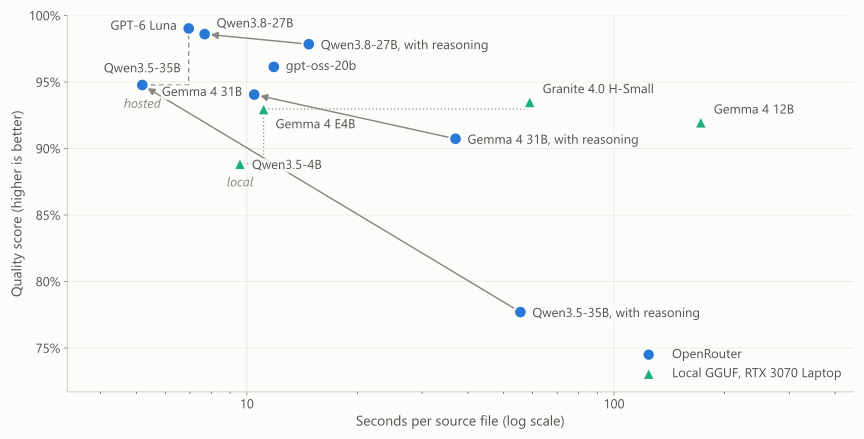
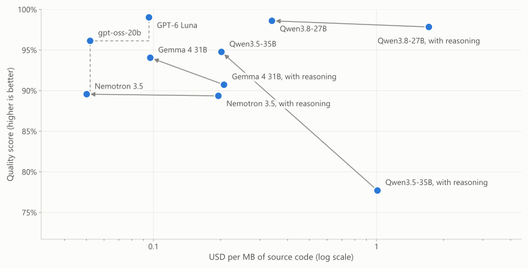
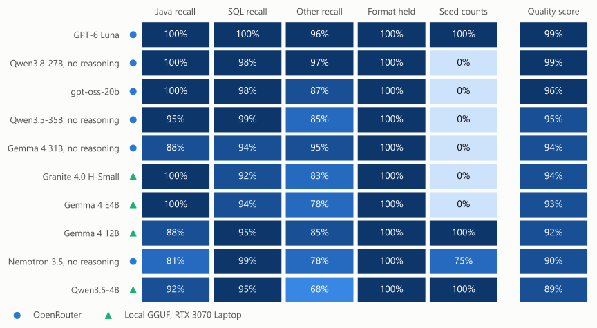

<!--
SPDX-FileCopyrightText: 2026 Bernard Ladenthin <bernard.ladenthin@gmail.com>
SPDX-License-Identifier: Apache-2.0

Render as Marp with HTML enabled. Model-card charts are referenced from the repository.
The PDF next to this file is rendered by render-presentation.py (headless Chrome or Edge, no Marp CLI);
render it again after every change of the deck or a deck chart.
-->
<svg xmlns="http://www.w3.org/2000/svg" width="1600" height="900" viewBox="0 0 1600 900"><defs><marker id="a" markerWidth="7" markerHeight="7" refX="6" refY="3" orient="auto" markerUnits="strokeWidth"><path d="M0 0 L0 6 L6 3 z" fill="#002db7"/></marker></defs><rect x="0" y="0" width="1600" height="900" rx="0" fill="#eaf0f9" stroke="#eaf0f9" stroke-width="2"/><text x="60" y="62" fill="#081f49" font-size="42" font-weight="700" text-anchor="start" font-family="Arial, sans-serif">Agents need a map of the source first</text><text x="62" y="98" fill="#4b6385" font-size="20" font-weight="400" text-anchor="start" font-family="Arial, sans-serif">Paths say too little · whole sources cost too much context · a map says where to look</text><line x1="60" y1="120" x2="1540" y2="120" stroke="#bdcce4" stroke-width="2"/><rect x="60" y="150" width="700" height="420" rx="17" fill="#f8faff" stroke="#bdcce4" stroke-width="2"/><text x="85" y="192" fill="#081f49" font-size="28" font-weight="700" text-anchor="start" font-family="Arial, sans-serif">Without a map</text><text x="85" y="250" fill="#4b6385" font-size="23" font-weight="400" text-anchor="start" font-family="Arial, sans-serif">The agent sees file names, greps,</text><text x="85" y="294" fill="#4b6385" font-size="23" font-weight="400" text-anchor="start" font-family="Arial, sans-serif">and opens file after file.</text><text x="85" y="352" fill="#4b6385" font-size="23" font-weight="400" text-anchor="start" font-family="Arial, sans-serif">Context fills with code the task</text><text x="85" y="396" fill="#4b6385" font-size="23" font-weight="400" text-anchor="start" font-family="Arial, sans-serif">never needed.</text><text x="85" y="454" fill="#4b6385" font-size="23" font-weight="400" text-anchor="start" font-family="Arial, sans-serif">Large or unfamiliar files (SQL dumps,</text><text x="85" y="498" fill="#4b6385" font-size="23" font-weight="400" text-anchor="start" font-family="Arial, sans-serif">XML, scripts) are skipped or cut off.</text><text x="85" y="542" fill="#4b6385" font-size="23" font-weight="400" text-anchor="start" font-family="Arial, sans-serif">Every new session starts from zero.</text><rect x="790" y="150" width="750" height="420" rx="17" fill="#002db7" stroke="#002db7" stroke-width="2"/><text x="815" y="192" fill="white" font-size="28" font-weight="700" text-anchor="start" font-family="Arial, sans-serif">With a map: zoom in</text><rect x="815" y="222" width="700" height="62" rx="12" fill="#1a45c4" stroke="#4f6fd6" stroke-width="2"/><text x="840" y="262" fill="white" font-size="24" font-weight="700" text-anchor="start" font-family="Arial, sans-serif">1</text><text x="880" y="262" fill="white" font-size="23" font-weight="700" text-anchor="start" font-family="Arial, sans-serif">project.ai.md</text><text x="1120" y="262" fill="#e4eaff" font-size="20" font-weight="400" text-anchor="start" font-family="Arial, sans-serif">one line per package</text><path d="M860 286 V300" fill="none" stroke="white" stroke-width="3"/><rect x="815" y="304" width="700" height="62" rx="12" fill="#1a45c4" stroke="#4f6fd6" stroke-width="2"/><text x="840" y="344" fill="white" font-size="24" font-weight="700" text-anchor="start" font-family="Arial, sans-serif">2</text><text x="880" y="344" fill="white" font-size="23" font-weight="700" text-anchor="start" font-family="Arial, sans-serif">package.ai.md</text><text x="1120" y="344" fill="#e4eaff" font-size="20" font-weight="400" text-anchor="start" font-family="Arial, sans-serif">one line per file</text><path d="M860 368 V382" fill="none" stroke="white" stroke-width="3"/><rect x="815" y="386" width="700" height="62" rx="12" fill="#1a45c4" stroke="#4f6fd6" stroke-width="2"/><text x="840" y="426" fill="white" font-size="24" font-weight="700" text-anchor="start" font-family="Arial, sans-serif">3</text><text x="880" y="426" fill="white" font-size="23" font-weight="700" text-anchor="start" font-family="Arial, sans-serif">&lt;file&gt;.ai.md</text><text x="1120" y="426" fill="#e4eaff" font-size="20" font-weight="400" text-anchor="start" font-family="Arial, sans-serif">purpose, API, exact facts</text><path d="M860 450 V464" fill="none" stroke="white" stroke-width="3"/><rect x="815" y="468" width="700" height="62" rx="12" fill="#1a45c4" stroke="#4f6fd6" stroke-width="2"/><text x="840" y="508" fill="white" font-size="24" font-weight="700" text-anchor="start" font-family="Arial, sans-serif">4</text><text x="880" y="508" fill="white" font-size="23" font-weight="700" text-anchor="start" font-family="Arial, sans-serif">the source</text><text x="1120" y="508" fill="#e4eaff" font-size="20" font-weight="400" text-anchor="start" font-family="Arial, sans-serif">only where exact detail is needed</text><rect x="60" y="600" width="1480" height="170" rx="17" fill="#dbe7fa" stroke="#bdcce4" stroke-width="2"/><text x="90" y="650" fill="#081f49" font-size="30" font-weight="700" text-anchor="start" font-family="Arial, sans-serif">srcmorph builds this map for any source tree</text><text x="90" y="695" fill="#4b6385" font-size="21" font-weight="400" text-anchor="start" font-family="Arial, sans-serif">One Markdown summary per file, package and project · Java, SQL, shell, Perl, XML and any other text file</text><text x="90" y="735" fill="#4b6385" font-size="21" font-weight="400" text-anchor="start" font-family="Arial, sans-serif">Local llama.cpp models or any OpenAI-compatible API · Maven plugin or CLI</text><text x="60" y="870" fill="#4b6385" font-size="15" font-weight="400" text-anchor="start" font-family="Arial, sans-serif">Summaries are lossy: the map says where to look, the source stays the reference.</text><text x="1530" y="870" fill="#4b6385" font-size="17" font-weight="400" text-anchor="end" font-family="Arial, sans-serif">1</text></svg>

Agents need a map of the source first: project, package, file summary, then the source only where needed.

<!--
An agent in an unknown repository either sees only paths or reads whole files. srcmorph writes a map instead: one Markdown summary per file, per package and for the project. The agent starts at the project map, zooms into the packages that matter and reads the source only where exact detail is needed. Summaries are lossy; the source remains the reference.
-->

---

<svg xmlns="http://www.w3.org/2000/svg" width="1600" height="900" viewBox="0 0 1600 900"><defs><marker id="a" markerWidth="7" markerHeight="7" refX="6" refY="3" orient="auto" markerUnits="strokeWidth"><path d="M0 0 L0 6 L6 3 z" fill="#002db7"/></marker></defs><rect x="0" y="0" width="1600" height="900" rx="0" fill="#eaf0f9" stroke="#eaf0f9" stroke-width="2"/><text x="60" y="62" fill="#081f49" font-size="42" font-weight="700" text-anchor="start" font-family="Arial, sans-serif">srcmorph: a navigable map of the source tree</text><text x="62" y="98" fill="#4b6385" font-size="20" font-weight="400" text-anchor="start" font-family="Arial, sans-serif">Project → package → file summaries · every kind of source · example: the benchmark corpus</text><line x1="60" y1="120" x2="1540" y2="120" stroke="#bdcce4" stroke-width="2"/><rect x="60" y="150" width="560" height="615" rx="24" fill="#f8faff" stroke="#bdcce4" stroke-width="2"/><text x="82" y="193" fill="#002db7" font-size="27" font-weight="700" text-anchor="start" font-family="Arial, sans-serif">project.ai.md</text><text x="82" y="221" fill="#4b6385" font-size="17" font-weight="400" text-anchor="start" font-family="Arial, sans-serif">Project map · one line per package</text><rect x="82" y="240" width="516" height="112" rx="16" fill="#edf2fa" stroke="#bdcce4" stroke-width="2"/><text x="102" y="272" fill="#081f49" font-size="19" font-weight="700" text-anchor="start" font-family="Arial, sans-serif">java/config / package.ai.md</text><rect x="102" y="288" width="233" height="48" rx="8" fill="#f8faff" stroke="#bdcce4" stroke-width="2"/><text x="114" y="319" fill="#4b6385" font-size="15" font-weight="400" text-anchor="start" font-family="Arial, sans-serif">AiConditionEvaluator.java.ai.md</text><rect x="345" y="288" width="233" height="48" rx="8" fill="#f8faff" stroke="#bdcce4" stroke-width="2"/><text x="357" y="319" fill="#4b6385" font-size="15" font-weight="400" text-anchor="start" font-family="Arial, sans-serif">AiFactExtractor.java.ai.md</text><rect x="82" y="367" width="516" height="112" rx="16" fill="#edf2fa" stroke="#bdcce4" stroke-width="2"/><text x="102" y="399" fill="#081f49" font-size="19" font-weight="700" text-anchor="start" font-family="Arial, sans-serif">sql/library / package.ai.md</text><rect x="102" y="415" width="233" height="48" rx="8" fill="#f8faff" stroke="#bdcce4" stroke-width="2"/><text x="114" y="446" fill="#4b6385" font-size="15" font-weight="400" text-anchor="start" font-family="Arial, sans-serif">01_schema.sql.ai.md</text><rect x="345" y="415" width="233" height="48" rx="8" fill="#f8faff" stroke="#bdcce4" stroke-width="2"/><text x="357" y="446" fill="#4b6385" font-size="15" font-weight="400" text-anchor="start" font-family="Arial, sans-serif">03_routines.sql.ai.md</text><rect x="82" y="494" width="516" height="112" rx="16" fill="#edf2fa" stroke="#bdcce4" stroke-width="2"/><text x="102" y="526" fill="#081f49" font-size="19" font-weight="700" text-anchor="start" font-family="Arial, sans-serif">other/scripts / package.ai.md</text><rect x="102" y="542" width="233" height="48" rx="8" fill="#f8faff" stroke="#bdcce4" stroke-width="2"/><text x="114" y="573" fill="#4b6385" font-size="15" font-weight="400" text-anchor="start" font-family="Arial, sans-serif">rotate_backups.sh.ai.md</text><rect x="345" y="542" width="233" height="48" rx="8" fill="#f8faff" stroke="#bdcce4" stroke-width="2"/><text x="357" y="573" fill="#4b6385" font-size="15" font-weight="400" text-anchor="start" font-family="Arial, sans-serif">sales_report.py.ai.md</text><rect x="82" y="621" width="516" height="112" rx="16" fill="#edf2fa" stroke="#bdcce4" stroke-width="2"/><text x="102" y="653" fill="#081f49" font-size="19" font-weight="700" text-anchor="start" font-family="Arial, sans-serif">other/ringbuf / package.ai.md</text><rect x="102" y="669" width="233" height="48" rx="8" fill="#f8faff" stroke="#bdcce4" stroke-width="2"/><text x="114" y="700" fill="#4b6385" font-size="15" font-weight="400" text-anchor="start" font-family="Arial, sans-serif">ringbuf.c.ai.md</text><rect x="345" y="669" width="233" height="48" rx="8" fill="#f8faff" stroke="#bdcce4" stroke-width="2"/><text x="357" y="700" fill="#4b6385" font-size="15" font-weight="400" text-anchor="start" font-family="Arial, sans-serif">ringbuf.h.ai.md</text><text x="82" y="805" fill="#4b6385" font-size="16" font-weight="400" text-anchor="start" font-family="Arial, sans-serif">The benchmark corpus: 24 files in 12 packages, 1 project map</text><rect x="650" y="150" width="890" height="150" rx="17" fill="#002db7" stroke="#002db7" stroke-width="2"/><text x="672" y="188" fill="white" font-size="30" font-weight="700" text-anchor="start" font-family="Arial, sans-serif">Give agents a map first</text><text x="672" y="222" fill="#e4eaff" font-size="21" font-weight="400" text-anchor="start" font-family="Arial, sans-serif">Start with the project · zoom into relevant packages</text><text x="672" y="254" fill="#e4eaff" font-size="21" font-weight="400" text-anchor="start" font-family="Arial, sans-serif">Read original files when exact detail is needed</text><rect x="650" y="320" width="890" height="135" rx="17" fill="#f8faff" stroke="#bdcce4" stroke-width="2"/><text x="672" y="358" fill="#081f49" font-size="25" font-weight="700" text-anchor="start" font-family="Arial, sans-serif">Every entry starts with a one-line lead</text><text x="672" y="392" fill="#4b6385" font-size="18" font-weight="400" text-anchor="start" font-family="Arial, sans-serif">The package and project maps are built from these leads,</text><text x="672" y="421" fill="#4b6385" font-size="18" font-weight="400" text-anchor="start" font-family="Arial, sans-serif">so each level reads like a legend of the level below.</text><rect x="650" y="475" width="890" height="135" rx="17" fill="#f8faff" stroke="#bdcce4" stroke-width="2"/><text x="672" y="513" fill="#081f49" font-size="25" font-weight="700" text-anchor="start" font-family="Arial, sans-serif">Exact facts beside the summary</text><text x="672" y="547" fill="#4b6385" font-size="18" font-weight="400" text-anchor="start" font-family="Arial, sans-serif">Counted by the profile's regular expressions over the whole file,</text><text x="672" y="576" fill="#4b6385" font-size="18" font-weight="400" text-anchor="start" font-family="Arial, sans-serif">not by the model: tables, functions, elements, dependencies ...</text><rect x="650" y="630" width="890" height="135" rx="17" fill="#f8faff" stroke="#bdcce4" stroke-width="2"/><text x="672" y="668" fill="#081f49" font-size="25" font-weight="700" text-anchor="start" font-family="Arial, sans-serif">Stays current in CI</text><text x="672" y="702" fill="#4b6385" font-size="18" font-weight="400" text-anchor="start" font-family="Arial, sans-serif">A source checksum in every header: a changed file rewrites its entry</text><text x="672" y="731" fill="#4b6385" font-size="18" font-weight="400" text-anchor="start" font-family="Arial, sans-serif">and the packages above it; unchanged entries stay as they are.</text><text x="60" y="870" fill="#4b6385" font-size="15" font-weight="400" text-anchor="start" font-family="Arial, sans-serif">Summaries are lossy. Actual agent token savings depend on the task and selected context.</text><text x="1530" y="870" fill="#4b6385" font-size="17" font-weight="400" text-anchor="end" font-family="Arial, sans-serif">2</text></svg>

srcmorph: a navigable map of the source tree, with one-line leads, exact facts and incremental updates.

<!--
The tree is the model card's corpus: Java, SQL, shell, Python, C and OpenCL files in 12 packages. Every summary starts with a one-line lead; package and project maps list those leads with links. Fact counters are regular expressions from the profile, counted over the whole file. A package checksum is computed from its children, so a changed file rewrites its own entry and the package maps above it; unchanged entries are not regenerated.
-->

---

<svg xmlns="http://www.w3.org/2000/svg" width="1600" height="900" viewBox="0 0 1600 900"><defs><marker id="a" markerWidth="7" markerHeight="7" refX="6" refY="3" orient="auto" markerUnits="strokeWidth"><path d="M0 0 L0 6 L6 3 z" fill="#002db7"/></marker></defs><rect x="0" y="0" width="1600" height="900" rx="0" fill="#eaf0f9" stroke="#eaf0f9" stroke-width="2"/><text x="60" y="62" fill="#081f49" font-size="42" font-weight="700" text-anchor="start" font-family="Arial, sans-serif">One entry of the map</text><text x="62" y="98" fill="#4b6385" font-size="20" font-weight="400" text-anchor="start" font-family="Arial, sans-serif">An 870 KB XML catalog, summarized by GPT-6 Luna in three chunks · large-file corpus, 2026-11-02</text><line x1="60" y1="120" x2="1540" y2="120" stroke="#bdcce4" stroke-width="2"/><rect x="60" y="150" width="880" height="640" rx="24" fill="#f8faff" stroke="#bdcce4" stroke-width="2"/><text x="88" y="192" fill="#081f49" font-size="19" font-weight="700" text-anchor="start" font-family="Consolas, 'Courier New', monospace" xml:space="preserve">### catalog.xml</text><text x="88" y="226" fill="#4b6385" font-size="19" font-weight="400" text-anchor="start" font-family="Consolas, 'Courier New', monospace" xml:space="preserve">- C: CCF59A7E</text><text x="88" y="260" fill="#4b6385" font-size="19" font-weight="400" text-anchor="start" font-family="Consolas, 'Courier New', monospace" xml:space="preserve">- X: file</text><text x="88" y="294" fill="#4b6385" font-size="19" font-weight="400" text-anchor="start" font-family="Consolas, 'Courier New', monospace" xml:space="preserve">- P: 80AA1478</text><text x="88" y="328" fill="#4b6385" font-size="19" font-weight="400" text-anchor="start" font-family="Consolas, 'Courier New', monospace" xml:space="preserve">- N: C0493A8E</text><text x="88" y="362" fill="#4b6385" font-size="19" font-weight="400" text-anchor="start" font-family="Consolas, 'Courier New', monospace" xml:space="preserve">---</text><text x="88" y="396" fill="#002db7" font-size="19" font-weight="700" text-anchor="start" font-family="Consolas, 'Courier New', monospace" xml:space="preserve">**Facts (exact, whole file):** elements: 20291;</text><text x="88" y="430" fill="#002db7" font-size="19" font-weight="700" text-anchor="start" font-family="Consolas, 'Courier New', monospace" xml:space="preserve">  namespace declarations: 2; id and name attributes: 80</text><text x="88" y="464" fill="#002db7" font-size="19" font-weight="700" text-anchor="start" font-family="Consolas, 'Courier New', monospace" xml:space="preserve">**Coverage:** 3 of 3 chunks summarized</text><text x="88" y="498" fill="#081f49" font-size="19" font-weight="700" text-anchor="start" font-family="Consolas, 'Courier New', monospace" xml:space="preserve">&gt; Defines a 40-category product catalog with EUR</text><text x="88" y="532" fill="#081f49" font-size="19" font-weight="700" text-anchor="start" font-family="Consolas, 'Courier New', monospace" xml:space="preserve">  pricing, warehouse inventory, and recall details</text><text x="88" y="566" fill="#081f49" font-size="19" font-weight="700" text-anchor="start" font-family="Consolas, 'Courier New', monospace" xml:space="preserve">#### Definitions</text><text x="88" y="600" fill="#4b6385" font-size="19" font-weight="400" text-anchor="start" font-family="Consolas, 'Courier New', monospace" xml:space="preserve">- Each category contains 125 product records;</text><text x="88" y="634" fill="#4b6385" font-size="19" font-weight="400" text-anchor="start" font-family="Consolas, 'Courier New', monospace" xml:space="preserve">  5,000 products total, SKU-001-0001 .. SKU-040-0125.</text><text x="88" y="668" fill="#4b6385" font-size="19" font-weight="400" text-anchor="start" font-family="Consolas, 'Courier New', monospace" xml:space="preserve">- Products in cat-020 and cat-021 also contain</text><text x="88" y="702" fill="#4b6385" font-size="19" font-weight="400" text-anchor="start" font-family="Consolas, 'Courier New', monospace" xml:space="preserve">  inv:recall: 250 recall records.</text><text x="88" y="736" fill="#081f49" font-size="19" font-weight="700" text-anchor="start" font-family="Consolas, 'Courier New', monospace" xml:space="preserve">#### Configuration · #### Dependencies · ...</text><rect x="970" y="150" width="570" height="145" rx="17" fill="#f8faff" stroke="#bdcce4" stroke-width="2"/><text x="992" y="188" fill="#081f49" font-size="25" font-weight="700" text-anchor="start" font-family="Arial, sans-serif">Header</text><text x="992" y="222" fill="#4b6385" font-size="19" font-weight="400" text-anchor="start" font-family="Arial, sans-serif">Source checksum (C), the prompt (P) and</text><text x="992" y="251" fill="#4b6385" font-size="19" font-weight="400" text-anchor="start" font-family="Arial, sans-serif">the fact counters (N) it was written with</text><rect x="970" y="315" width="570" height="145" rx="17" fill="#002db7" stroke="#002db7" stroke-width="2"/><text x="992" y="353" fill="white" font-size="25" font-weight="700" text-anchor="start" font-family="Arial, sans-serif">Facts line</text><text x="992" y="387" fill="#e4eaff" font-size="19" font-weight="400" text-anchor="start" font-family="Arial, sans-serif">Exact counts over the whole file,</text><text x="992" y="416" fill="#e4eaff" font-size="19" font-weight="400" text-anchor="start" font-family="Arial, sans-serif">by the profile's regular expressions</text><rect x="970" y="480" width="570" height="145" rx="17" fill="#f8faff" stroke="#bdcce4" stroke-width="2"/><text x="992" y="518" fill="#081f49" font-size="25" font-weight="700" text-anchor="start" font-family="Arial, sans-serif">Coverage line</text><text x="992" y="552" fill="#4b6385" font-size="19" font-weight="400" text-anchor="start" font-family="Arial, sans-serif">What the model read: every chunk,</text><text x="992" y="581" fill="#4b6385" font-size="19" font-weight="400" text-anchor="start" font-family="Arial, sans-serif">or a sample of a very large file</text><rect x="970" y="645" width="570" height="145" rx="17" fill="#f8faff" stroke="#bdcce4" stroke-width="2"/><text x="992" y="683" fill="#081f49" font-size="25" font-weight="700" text-anchor="start" font-family="Arial, sans-serif">Lead and sections</text><text x="992" y="717" fill="#4b6385" font-size="19" font-weight="400" text-anchor="start" font-family="Arial, sans-serif">The lead goes into the package map;</text><text x="992" y="746" fill="#4b6385" font-size="19" font-weight="400" text-anchor="start" font-family="Arial, sans-serif">the sections depend on the file kind</text><text x="60" y="870" fill="#4b6385" font-size="15" font-weight="400" text-anchor="start" font-family="Arial, sans-serif">Excerpt: five header lines (format version, dates, plugin and AI version) and most sections left out.</text><text x="1530" y="870" fill="#4b6385" font-size="17" font-weight="400" text-anchor="end" font-family="Arial, sans-serif">3</text></svg>

One entry of the map: header with checksum and profile hashes, exact facts line, coverage line, lead and sections.

<!--
A real file summary from docs/ai-index-benchmark/remeasure-2026-11-02/large/run1: the 870 KB XML catalog of the large-file corpus, which no window of the tested models holds, summarized in three chunks. The facts line is counted by srcmorph, not by the model. The Definitions section names the inv:recall element planted in the middle of the file. The header records the source checksum and the CRC32 of the prompt and the fact counters the entry was written with.
-->

---

<svg xmlns="http://www.w3.org/2000/svg" width="1600" height="900" viewBox="0 0 1600 900"><defs><marker id="a" markerWidth="7" markerHeight="7" refX="6" refY="3" orient="auto" markerUnits="strokeWidth"><path d="M0 0 L0 6 L6 3 z" fill="#002db7"/></marker></defs><rect x="0" y="0" width="1600" height="900" rx="0" fill="#eaf0f9" stroke="#eaf0f9" stroke-width="2"/><text x="60" y="62" fill="#081f49" font-size="42" font-weight="700" text-anchor="start" font-family="Arial, sans-serif">Any kind of source: a prompt and exact facts per kind</text><text x="62" y="98" fill="#4b6385" font-size="20" font-weight="400" text-anchor="start" font-family="Arial, sans-serif">Rules route each file by path, extension and size · one profile directory (profiles/v3) · keys, not pasted text</text><line x1="60" y1="120" x2="1540" y2="120" stroke="#bdcce4" stroke-width="2"/><rect x="60" y="150" width="480" height="200" rx="17" fill="#f8faff" stroke="#bdcce4" stroke-width="2"/><text x="82" y="190" fill="#081f49" font-size="24" font-weight="700" text-anchor="start" font-family="Arial, sans-serif">Java</text><text x="82" y="232" fill="#002db7" font-size="15" font-weight="700" text-anchor="start" font-family="Arial, sans-serif">Sections</text><text x="82" y="258" fill="#4b6385" font-size="18" font-weight="400" text-anchor="start" font-family="Arial, sans-serif">Purpose · Public API · Core logic · Concurrency</text><text x="82" y="298" fill="#002db7" font-size="15" font-weight="700" text-anchor="start" font-family="Arial, sans-serif">Exact facts</text><text x="82" y="324" fill="#4b6385" font-size="18" font-weight="400" text-anchor="start" font-family="Arial, sans-serif">types · methods · constructors · fields</text><rect x="560" y="150" width="480" height="200" rx="17" fill="#f8faff" stroke="#bdcce4" stroke-width="2"/><text x="582" y="190" fill="#081f49" font-size="24" font-weight="700" text-anchor="start" font-family="Arial, sans-serif">SQL</text><text x="582" y="232" fill="#002db7" font-size="15" font-weight="700" text-anchor="start" font-family="Arial, sans-serif">Sections</text><text x="582" y="258" fill="#4b6385" font-size="18" font-weight="400" text-anchor="start" font-family="Arial, sans-serif">Schema · Reads · Writes · Relationships</text><text x="582" y="298" fill="#002db7" font-size="15" font-weight="700" text-anchor="start" font-family="Arial, sans-serif">Exact facts</text><text x="582" y="324" fill="#4b6385" font-size="18" font-weight="400" text-anchor="start" font-family="Arial, sans-serif">tables · views · indexes · INSERTs · rows</text><rect x="1060" y="150" width="480" height="200" rx="17" fill="#f8faff" stroke="#bdcce4" stroke-width="2"/><text x="1082" y="190" fill="#081f49" font-size="24" font-weight="700" text-anchor="start" font-family="Arial, sans-serif">Shell: Bash · POSIX sh · ksh93</text><text x="1082" y="232" fill="#002db7" font-size="15" font-weight="700" text-anchor="start" font-family="Arial, sans-serif">Sections</text><text x="1082" y="258" fill="#4b6385" font-size="18" font-weight="400" text-anchor="start" font-family="Arial, sans-serif">Functions · Configuration · Exit codes</text><text x="1082" y="298" fill="#002db7" font-size="15" font-weight="700" text-anchor="start" font-family="Arial, sans-serif">Exact facts</text><text x="1082" y="324" fill="#4b6385" font-size="18" font-weight="400" text-anchor="start" font-family="Arial, sans-serif">functions · options · traps · set -e</text><rect x="60" y="370" width="480" height="200" rx="17" fill="#f8faff" stroke="#bdcce4" stroke-width="2"/><text x="82" y="410" fill="#081f49" font-size="24" font-weight="700" text-anchor="start" font-family="Arial, sans-serif">Perl</text><text x="82" y="452" fill="#002db7" font-size="15" font-weight="700" text-anchor="start" font-family="Arial, sans-serif">Sections</text><text x="82" y="478" fill="#4b6385" font-size="18" font-weight="400" text-anchor="start" font-family="Arial, sans-serif">Subs · Constants and configuration</text><text x="82" y="518" fill="#002db7" font-size="15" font-weight="700" text-anchor="start" font-family="Arial, sans-serif">Exact facts</text><text x="82" y="544" fill="#4b6385" font-size="18" font-weight="400" text-anchor="start" font-family="Arial, sans-serif">packages · subs · modules · GetOptions</text><rect x="560" y="370" width="480" height="200" rx="17" fill="#f8faff" stroke="#bdcce4" stroke-width="2"/><text x="582" y="410" fill="#081f49" font-size="24" font-weight="700" text-anchor="start" font-family="Arial, sans-serif">XML: POM · Spring · XSD · XSLT</text><text x="582" y="452" fill="#002db7" font-size="15" font-weight="700" text-anchor="start" font-family="Arial, sans-serif">Sections</text><text x="582" y="478" fill="#4b6385" font-size="18" font-weight="400" text-anchor="start" font-family="Arial, sans-serif">Definitions · Configuration · Dependencies</text><text x="582" y="518" fill="#002db7" font-size="15" font-weight="700" text-anchor="start" font-family="Arial, sans-serif">Exact facts</text><text x="582" y="544" fill="#4b6385" font-size="18" font-weight="400" text-anchor="start" font-family="Arial, sans-serif">elements · beans · types · plugins</text><rect x="1060" y="370" width="480" height="200" rx="17" fill="#f8faff" stroke="#bdcce4" stroke-width="2"/><text x="1082" y="410" fill="#081f49" font-size="24" font-weight="700" text-anchor="start" font-family="Arial, sans-serif">Any other file: C, Python, ...</text><text x="1082" y="452" fill="#002db7" font-size="15" font-weight="700" text-anchor="start" font-family="Arial, sans-serif">Sections</text><text x="1082" y="478" fill="#4b6385" font-size="18" font-weight="400" text-anchor="start" font-family="Arial, sans-serif">Fallback prompt: Purpose · Input · Output</text><text x="1082" y="518" fill="#002db7" font-size="15" font-weight="700" text-anchor="start" font-family="Arial, sans-serif">Exact facts</text><text x="1082" y="544" fill="#4b6385" font-size="18" font-weight="400" text-anchor="start" font-family="Arial, sans-serif">no counters unless a profile adds them</text><rect x="60" y="600" width="1480" height="170" rx="17" fill="#002db7" stroke="#002db7" stroke-width="2"/><text x="90" y="645" fill="white" font-size="27" font-weight="700" text-anchor="start" font-family="Arial, sans-serif">Own prompts for shell, Perl and XML, measured</text><text x="90" y="688" fill="#e4eaff" font-size="20" font-weight="400" text-anchor="start" font-family="Arial, sans-serif">Language corpus (Perl, Bash, ksh93, POSIX sh, POM, Spring, XSD, XSLT), generic → own prompt:</text><text x="90" y="728" fill="white" font-size="22" font-weight="700" text-anchor="start" font-family="Arial, sans-serif">gpt-oss-20b 95.7 → 97.7 %   ·   GPT-6 Luna 99.6 → 99.9 %   (name recall + format, 3 / 6 runs)</text><text x="60" y="870" fill="#4b6385" font-size="15" font-weight="400" text-anchor="start" font-family="Arial, sans-serif">Fact counters ignore POD, heredocs and comments ([ignore] regions). gpt-oss-20b: 99.1 % over the six own-prompt runs without one empty provider answer.</text><text x="1530" y="870" fill="#4b6385" font-size="17" font-weight="400" text-anchor="end" font-family="Arial, sans-serif">4</text></svg>

Any kind of source: Java, SQL, shell, Perl and XML each get their own prompt and exact fact counters; anything else takes the fallback prompt.

<!--
A profile is one directory: a prompt file and a fact-counter file per key. Rules route a file by path, extension and size to a model, a prompt and a fact counter. The shell, Perl and XML prompts were added after the generic prompt lost a deploy script's options and a POM's plugins on the language corpus. Measured on OpenRouter: gpt-oss-20b rose from 95.7 to 97.7 % (99.1 % without one empty provider answer), GPT-6 Luna from 99.6 to 99.9 %. See profiles/README.md and finding 7 of ai-index-benchmark/MODEL-CARD.md.
-->

---

<svg xmlns="http://www.w3.org/2000/svg" width="1600" height="900" viewBox="0 0 1600 900"><defs><marker id="a" markerWidth="7" markerHeight="7" refX="6" refY="3" orient="auto" markerUnits="strokeWidth"><path d="M0 0 L0 6 L6 3 z" fill="#002db7"/></marker></defs><rect x="0" y="0" width="1600" height="900" rx="0" fill="#eaf0f9" stroke="#eaf0f9" stroke-width="2"/><text x="60" y="62" fill="#081f49" font-size="42" font-weight="700" text-anchor="start" font-family="Arial, sans-serif">Does the map lead to the right file?</text><text x="62" y="98" fill="#4b6385" font-size="20" font-weight="400" text-anchor="start" font-family="Arial, sans-serif">43 developer questions · 24 files · a separate reader model names the file that answers</text><line x1="60" y1="120" x2="1540" y2="120" stroke="#bdcce4" stroke-width="2"/><rect x="60" y="150" width="900" height="620" rx="24" fill="#f8faff" stroke="#bdcce4" stroke-width="2"/><text x="90" y="195" fill="#4b6385" font-size="19" font-weight="700" text-anchor="start" font-family="Arial, sans-serif">READER FINDS AN ANSWER FILE FIRST (HIT@1)</text><line x1="330.0" y1="225" x2="330.0" y2="690" stroke="#bdcce4" stroke-width="1"/><text x="330.0" y="720" fill="#4b6385" font-size="16" font-weight="400" text-anchor="middle" font-family="Arial, sans-serif">0 %</text><line x1="470.0" y1="225" x2="470.0" y2="690" stroke="#bdcce4" stroke-width="1"/><text x="470.0" y="720" fill="#4b6385" font-size="16" font-weight="400" text-anchor="middle" font-family="Arial, sans-serif">25 %</text><line x1="610.0" y1="225" x2="610.0" y2="690" stroke="#bdcce4" stroke-width="1"/><text x="610.0" y="720" fill="#4b6385" font-size="16" font-weight="400" text-anchor="middle" font-family="Arial, sans-serif">50 %</text><line x1="750.0" y1="225" x2="750.0" y2="690" stroke="#bdcce4" stroke-width="1"/><text x="750.0" y="720" fill="#4b6385" font-size="16" font-weight="400" text-anchor="middle" font-family="Arial, sans-serif">75 %</text><line x1="890.0" y1="225" x2="890.0" y2="690" stroke="#bdcce4" stroke-width="1"/><text x="890.0" y="720" fill="#4b6385" font-size="16" font-weight="400" text-anchor="middle" font-family="Arial, sans-serif">100 %</text><text x="90" y="290" fill="#081f49" font-size="24" font-weight="700" text-anchor="start" font-family="Arial, sans-serif">Paths only</text><text x="90" y="320" fill="#4b6385" font-size="17" font-weight="400" text-anchor="start" font-family="Arial, sans-serif">file names, no content</text><rect x="330" y="265" width="414.4" height="70" rx="8" fill="#9fb3d1" stroke="#9fb3d1" stroke-width="2"/><text x="732.4" y="310" fill="#081f49" font-size="24" font-weight="700" text-anchor="end" font-family="Arial, sans-serif">74 %</text><text x="90" y="430" fill="#081f49" font-size="24" font-weight="700" text-anchor="start" font-family="Arial, sans-serif">Whole source</text><text x="90" y="460" fill="#4b6385" font-size="17" font-weight="400" text-anchor="start" font-family="Arial, sans-serif">≈ 65,000 tokens</text><rect x="330" y="405" width="403.2" height="70" rx="8" fill="#9fb3d1" stroke="#9fb3d1" stroke-width="2"/><text x="721.2" y="450" fill="#081f49" font-size="24" font-weight="700" text-anchor="end" font-family="Arial, sans-serif">72 %</text><text x="90" y="570" fill="#081f49" font-size="24" font-weight="700" text-anchor="start" font-family="Arial, sans-serif">The map</text><text x="90" y="600" fill="#4b6385" font-size="17" font-weight="400" text-anchor="start" font-family="Arial, sans-serif">≈ 16,000 tokens</text><rect x="330" y="545" width="470.4" height="70" rx="8" fill="#002db7" stroke="#002db7" stroke-width="2"/><rect x="800.4" y="545" width="89.6" height="70" rx="8" fill="#7f97e0" stroke="#7f97e0" stroke-width="2"/><text x="878.0" y="590" fill="white" font-size="24" font-weight="700" text-anchor="end" font-family="Arial, sans-serif">84–100 %</text><text x="90" y="755" fill="#4b6385" font-size="16" font-weight="400" text-anchor="start" font-family="Arial, sans-serif">The map: 32 of 35 model runs; the other three had empty or malformed summaries.</text><rect x="990" y="150" width="550" height="190" rx="17" fill="#002db7" stroke="#002db7" stroke-width="2"/><text x="1012" y="188" fill="white" font-size="25" font-weight="700" text-anchor="start" font-family="Arial, sans-serif">About 4× less context</text><text x="1012" y="222" fill="#e4eaff" font-size="19" font-weight="400" text-anchor="start" font-family="Arial, sans-serif">and more questions answered first</text><text x="1012" y="251" fill="#e4eaff" font-size="19" font-weight="400" text-anchor="start" font-family="Arial, sans-serif">than with the whole source or the</text><text x="1012" y="280" fill="#e4eaff" font-size="19" font-weight="400" text-anchor="start" font-family="Arial, sans-serif">paths alone.</text><rect x="990" y="360" width="550" height="200" rx="17" fill="#f8faff" stroke="#bdcce4" stroke-width="2"/><text x="1012" y="398" fill="#081f49" font-size="25" font-weight="700" text-anchor="start" font-family="Arial, sans-serif">Keyword search does not gain</text><text x="1012" y="432" fill="#4b6385" font-size="19" font-weight="400" text-anchor="start" font-family="Arial, sans-serif">Keyword ranking (BM25, as in classic</text><text x="1012" y="461" fill="#4b6385" font-size="19" font-weight="400" text-anchor="start" font-family="Arial, sans-serif">search engines): 67–91 % first over the</text><text x="1012" y="490" fill="#4b6385" font-size="19" font-weight="400" text-anchor="start" font-family="Arial, sans-serif">summaries (81 % on average), 84 %</text><text x="1012" y="519" fill="#4b6385" font-size="19" font-weight="400" text-anchor="start" font-family="Arial, sans-serif">over the source; 9 of 35 runs beat it.</text><rect x="990" y="580" width="550" height="190" rx="17" fill="#f8faff" stroke="#bdcce4" stroke-width="2"/><text x="1012" y="618" fill="#081f49" font-size="25" font-weight="700" text-anchor="start" font-family="Arial, sans-serif">Missing entries hurt, not names</text><text x="1012" y="652" fill="#4b6385" font-size="19" font-weight="400" text-anchor="start" font-family="Arial, sans-serif">An empty summary costs hits; a</text><text x="1012" y="681" fill="#4b6385" font-size="19" font-weight="400" text-anchor="start" font-family="Arial, sans-serif">missing name rarely does. The map</text><text x="1012" y="710" fill="#4b6385" font-size="19" font-weight="400" text-anchor="start" font-family="Arial, sans-serif">is for models, not grep.</text><text x="60" y="870" fill="#4b6385" font-size="15" font-weight="400" text-anchor="start" font-family="Arial, sans-serif">Reader: Mistral Small 3.2 24B, not one of the tested models. Questions written from the sources before any summary was read. 24 files make an easy test.</text><text x="1530" y="870" fill="#4b6385" font-size="17" font-weight="400" text-anchor="end" font-family="Arial, sans-serif">5</text></svg>

Does the map lead to the right file? With the summaries a reader model finds 84–100 % of the answers first, with paths 74 %, with the whole source 72 %.

<!--
The search measurement of ai-index-benchmark/MODEL-CARD.md: 43 developer questions, each with the corpus file that answers it, written from the sources before any summary was read. The reader, Mistral Small 3.2 24B, sees every summary under its path and names the three most likely files. With the summaries of 32 of 35 runs it finds 84 to 100 % of the answers first; with the paths alone 74 %; with the whole source (about 65,000 tokens instead of about 16,000) 72 %. BM25 over the summaries finds 67 to 91 % first, 81 % on average, over the source 84 %: 9 of the 35 runs beat the source by one to three questions, 22 fall behind it. With 24 files the test separates broken summaries from working ones, not good from better ones.
-->

---

<svg xmlns="http://www.w3.org/2000/svg" width="1600" height="900" viewBox="0 0 1600 900"><defs><marker id="a" markerWidth="7" markerHeight="7" refX="6" refY="3" orient="auto" markerUnits="strokeWidth"><path d="M0 0 L0 6 L6 3 z" fill="#002db7"/></marker></defs><rect x="0" y="0" width="1600" height="900" rx="0" fill="#eaf0f9" stroke="#eaf0f9" stroke-width="2"/><text x="60" y="62" fill="#081f49" font-size="42" font-weight="700" text-anchor="start" font-family="Arial, sans-serif">Measured: a compact entry point for agents</text><text x="62" y="98" fill="#4b6385" font-size="20" font-weight="400" text-anchor="start" font-family="Arial, sans-serif">October 2026 model card · 24 source files · GPT-6 Luna (hosted)</text><line x1="60" y1="120" x2="1540" y2="120" stroke="#bdcce4" stroke-width="2"/><rect x="60" y="155" width="915" height="590" rx="24" fill="#f8faff" stroke="#bdcce4" stroke-width="2"/><text x="90" y="198" fill="#4b6385" font-size="19" font-weight="700" text-anchor="start" font-family="Arial, sans-serif">CORPUS AND COMPLETE MARKDOWN INDEX</text><text x="90" y="270" fill="#081f49" font-size="23" font-weight="700" text-anchor="start" font-family="Arial, sans-serif">Source corpus</text><text x="90" y="302" fill="#4b6385" font-size="18" font-weight="400" text-anchor="start" font-family="Arial, sans-serif">Java · SQL · C · OpenCL · Python · Bash</text><rect x="90" y="322" width="800" height="65" rx="10" fill="#dbe7fa" stroke="#bdcce4" stroke-width="2"/><text x="115" y="365" fill="#081f49" font-size="29" font-weight="700" text-anchor="start" font-family="Arial, sans-serif">234.6 KB</text><text x="90" y="442" fill="#081f49" font-size="23" font-weight="700" text-anchor="start" font-family="Arial, sans-serif">Complete index</text><text x="90" y="473" fill="#4b6385" font-size="18" font-weight="400" text-anchor="start" font-family="Arial, sans-serif">24 file + 12 package + 1 project Markdown</text><rect x="90" y="493" width="376" height="65" rx="10" fill="#002db7" stroke="#002db7" stroke-width="2"/><text x="110" y="536" fill="white" font-size="28" font-weight="700" text-anchor="start" font-family="Arial, sans-serif">110.2 KB</text><text x="491" y="536" fill="#002db7" font-size="27" font-weight="700" text-anchor="start" font-family="Arial, sans-serif">−53% by bytes</text><text x="90" y="628" fill="#081f49" font-size="25" font-weight="700" text-anchor="start" font-family="Arial, sans-serif">Project entry: 3.06 KB  ·  1.30% of source</text><text x="90" y="669" fill="#4b6385" font-size="19" font-weight="400" text-anchor="start" font-family="Arial, sans-serif">Start here, then load only relevant package / file maps.</text><rect x="1005" y="155" width="535" height="590" rx="24" fill="#002db7" stroke="#002db7" stroke-width="2"/><text x="1035" y="203" fill="#e4eaff" font-size="19" font-weight="700" text-anchor="start" font-family="Arial, sans-serif">FILE SUMMARY BODIES</text><text x="1035" y="285" fill="white" font-size="57" font-weight="700" text-anchor="start" font-family="Arial, sans-serif">4.09×</text><text x="1035" y="320" fill="#e4eaff" font-size="20" font-weight="400" text-anchor="start" font-family="Arial, sans-serif">Java source / summary bytes</text><text x="1035" y="397" fill="white" font-size="57" font-weight="700" text-anchor="start" font-family="Arial, sans-serif">4.29×</text><text x="1035" y="432" fill="#e4eaff" font-size="20" font-weight="400" text-anchor="start" font-family="Arial, sans-serif">SQL source / summary bytes</text><text x="1035" y="508" fill="white" font-size="52" font-weight="700" text-anchor="start" font-family="Arial, sans-serif">100%</text><text x="1035" y="543" fill="#e4eaff" font-size="20" font-weight="400" text-anchor="start" font-family="Arial, sans-serif">Java name recall (proxy)</text><text x="1035" y="634" fill="#e4eaff" font-size="17" font-weight="400" text-anchor="start" font-family="Arial, sans-serif">One corpus · hosted via OpenRouter</text><text x="1035" y="665" fill="#e4eaff" font-size="17" font-weight="400" text-anchor="start" font-family="Arial, sans-serif">Small files can produce larger summaries.</text><text x="60" y="870" fill="#4b6385" font-size="15" font-weight="400" text-anchor="start" font-family="Arial, sans-serif">KB = 1,000 bytes; full index includes headers. Body ratios exclude headers; byte reduction is not measured token savings.</text><text x="1530" y="870" fill="#4b6385" font-size="17" font-weight="400" text-anchor="end" font-family="Arial, sans-serif">6</text></svg>

Measured: 24 source files (234.6 KB) → complete Markdown index (110.2 KB); project entry 3.06 KB. GPT-6 Luna, hosted.

<!--
The October model-card corpus has 24 files and 234,605 source bytes. The hosted GPT-6 Luna output tree contains 37 Markdown files totaling 110,199 bytes including headers; project.ai.md has 3,061 bytes. Java and SQL source-to-body byte ratios exclude headers and aggregation. Name recall is a proxy and byte reduction is not a measurement of downstream token savings. See ai-index-benchmark/MODEL-CARD.md.
-->

---

<svg xmlns="http://www.w3.org/2000/svg" width="1600" height="900" viewBox="0 0 1600 900"><defs><marker id="a" markerWidth="7" markerHeight="7" refX="6" refY="3" orient="auto" markerUnits="strokeWidth"><path d="M0 0 L0 6 L6 3 z" fill="#002db7"/></marker></defs><rect x="0" y="0" width="1600" height="900" rx="0" fill="#eaf0f9" stroke="#eaf0f9" stroke-width="2"/><text x="60" y="62" fill="#081f49" font-size="42" font-weight="700" text-anchor="start" font-family="Arial, sans-serif">Large files: every chunk read, facts over the whole file</text><text x="62" y="98" fill="#4b6385" font-size="20" font-weight="400" text-anchor="start" font-family="Arial, sans-serif">1.6 MB SQL dump · 870 KB XML catalog · 283 KB Java enum · names planted in the middle of each</text><line x1="60" y1="120" x2="1540" y2="120" stroke="#bdcce4" stroke-width="2"/><rect x="60" y="150" width="700" height="620" rx="24" fill="#f8faff" stroke="#bdcce4" stroke-width="2"/><text x="88" y="195" fill="#4b6385" font-size="19" font-weight="700" text-anchor="start" font-family="Arial, sans-serif">MAP-REDUCE OVER A FILE NO WINDOW HOLDS</text><rect x="88" y="220" width="644" height="60" rx="10" fill="#dbe7fa" stroke="#bdcce4" stroke-width="2"/><text x="110" y="259" fill="#081f49" font-size="21" font-weight="700" text-anchor="start" font-family="Arial, sans-serif">ledger_dump.sql · 1.6 MB · 30,000 rows</text><path d="M410 284 V312" fill="none" stroke="#002db7" stroke-width="4" marker-end="url(#a)"/><rect x="88" y="322" width="97" height="50" rx="8" fill="#edf2fa" stroke="#bdcce4" stroke-width="2"/><text x="136" y="354" fill="#4b6385" font-size="16" font-weight="400" text-anchor="middle" font-family="Arial, sans-serif">chunk 1</text><rect x="197" y="322" width="97" height="50" rx="8" fill="#edf2fa" stroke="#bdcce4" stroke-width="2"/><text x="245" y="354" fill="#4b6385" font-size="16" font-weight="400" text-anchor="middle" font-family="Arial, sans-serif">chunk 2</text><rect x="306" y="322" width="97" height="50" rx="8" fill="#edf2fa" stroke="#bdcce4" stroke-width="2"/><text x="354" y="354" fill="#4b6385" font-size="16" font-weight="400" text-anchor="middle" font-family="Arial, sans-serif">chunk 3</text><rect x="415" y="322" width="97" height="50" rx="8" fill="#edf2fa" stroke="#bdcce4" stroke-width="2"/><text x="463" y="354" fill="#4b6385" font-size="16" font-weight="400" text-anchor="middle" font-family="Arial, sans-serif">chunk 4</text><rect x="524" y="322" width="97" height="50" rx="8" fill="#edf2fa" stroke="#bdcce4" stroke-width="2"/><text x="572" y="354" fill="#4b6385" font-size="16" font-weight="400" text-anchor="middle" font-family="Arial, sans-serif">chunk 5</text><rect x="633" y="322" width="97" height="50" rx="8" fill="#edf2fa" stroke="#bdcce4" stroke-width="2"/><text x="681" y="354" fill="#4b6385" font-size="16" font-weight="400" text-anchor="middle" font-family="Arial, sans-serif">…</text><text x="88" y="400" fill="#4b6385" font-size="18" font-weight="400" text-anchor="start" font-family="Arial, sans-serif">map: one part summary per chunk, every chunk read</text><path d="M410 412 V440" fill="none" stroke="#002db7" stroke-width="4" marker-end="url(#a)"/><rect x="88" y="450" width="644" height="60" rx="10" fill="#edf2fa" stroke="#bdcce4" stroke-width="2"/><text x="110" y="489" fill="#081f49" font-size="21" font-weight="700" text-anchor="start" font-family="Arial, sans-serif">reduce: one summary of the parts</text><path d="M410 514 V542" fill="none" stroke="#002db7" stroke-width="4" marker-end="url(#a)"/><rect x="88" y="552" width="644" height="110" rx="10" fill="#002db7" stroke="#002db7" stroke-width="2"/><text x="110" y="592" fill="white" font-size="21" font-weight="700" text-anchor="start" font-family="Arial, sans-serif">Facts line: counted over the whole file</text><text x="110" y="626" fill="#e4eaff" font-size="19" font-weight="400" text-anchor="start" font-family="Arial, sans-serif">Coverage line: what was read · summary</text><text x="88" y="705" fill="#4b6385" font-size="17" font-weight="400" text-anchor="start" font-family="Arial, sans-serif">Over 1 MB a rule may sample chunks; the coverage line says so.</text><text x="88" y="735" fill="#4b6385" font-size="17" font-weight="400" text-anchor="start" font-family="Arial, sans-serif">A part answered with reasoning only is read again in two halves.</text><rect x="790" y="150" width="750" height="190" rx="17" fill="#f8faff" stroke="#bdcce4" stroke-width="2"/><text x="812" y="188" fill="#081f49" font-size="25" font-weight="700" text-anchor="start" font-family="Arial, sans-serif">GPT-6 Luna · hosted</text><text x="812" y="222" fill="#4b6385" font-size="21" font-weight="400" text-anchor="start" font-family="Arial, sans-serif">99.0 % mean of 3 runs (100 / 96.9 / 100 %)</text><text x="812" y="256" fill="#4b6385" font-size="21" font-weight="400" text-anchor="start" font-family="Arial, sans-serif">Every name planted in a file's middle, in every run</text><rect x="790" y="365" width="750" height="190" rx="17" fill="#f8faff" stroke="#bdcce4" stroke-width="2"/><text x="812" y="403" fill="#081f49" font-size="25" font-weight="700" text-anchor="start" font-family="Arial, sans-serif">gpt-oss-20b · hosted</text><text x="812" y="437" fill="#4b6385" font-size="21" font-weight="400" text-anchor="start" font-family="Arial, sans-serif">93.0 % mean of 3 runs (88.3 / 93.8 / 96.9 %)</text><text x="812" y="471" fill="#4b6385" font-size="21" font-weight="400" text-anchor="start" font-family="Arial, sans-serif">Every file written; the dump's middle table or index</text><text x="812" y="505" fill="#4b6385" font-size="21" font-weight="400" text-anchor="start" font-family="Arial, sans-serif">in every run, the enum's middle in none</text><rect x="790" y="580" width="750" height="190" rx="17" fill="#f8faff" stroke="#bdcce4" stroke-width="2"/><text x="812" y="618" fill="#081f49" font-size="25" font-weight="700" text-anchor="start" font-family="Arial, sans-serif">Granite 4.0 H-Tiny · local, 8 GB GPU</text><text x="812" y="652" fill="#4b6385" font-size="21" font-weight="400" text-anchor="start" font-family="Arial, sans-serif">64–71 % (71.0 / 64.2 / 64.5 %) · every file written</text><text x="812" y="686" fill="#4b6385" font-size="21" font-weight="400" text-anchor="start" font-family="Arial, sans-serif">No planted middle name; invents names</text><text x="812" y="720" fill="#4b6385" font-size="21" font-weight="400" text-anchor="start" font-family="Arial, sans-serif">beside the real ones</text><text x="60" y="870" fill="#4b6385" font-size="15" font-weight="400" text-anchor="start" font-family="Arial, sans-serif">Re-measurement 2026-11-02, three runs each; quality = name recall + format. Small local models are not yet good enough for files this large.</text><text x="1530" y="870" fill="#4b6385" font-size="17" font-weight="400" text-anchor="end" font-family="Arial, sans-serif">7</text></svg>

Large files: map-reduce reads every chunk, facts and coverage lines are exact; GPT-6 Luna finds every planted middle name.

<!--
The large-file corpus of modelcard/large.py plants a table, an XML element and an error-code area in the middle of each file. Re-measurement of 2026-11-02 (docs/ai-index-benchmark/remeasure-2026-11-02): GPT-6 Luna 100 / 96.9 / 100 %, every planted middle name in every run; gpt-oss-20b with the fix for parts answered with reasoning only 88.3 / 93.8 / 96.9 %, the dump's middle table or index in every run, the enum's middle in none; Granite 4.0 H-Tiny locally with the XML prompt 71.0 / 64.2 / 64.5 %, no planted middle name and invented names beside the real ones.
-->

---

<svg xmlns="http://www.w3.org/2000/svg" width="1600" height="900" viewBox="0 0 1600 900"><defs><marker id="a" markerWidth="7" markerHeight="7" refX="6" refY="3" orient="auto" markerUnits="strokeWidth"><path d="M0 0 L0 6 L6 3 z" fill="#002db7"/></marker></defs><rect x="0" y="0" width="1600" height="900" rx="0" fill="#eaf0f9" stroke="#eaf0f9" stroke-width="2"/><text x="60" y="62" fill="#081f49" font-size="42" font-weight="700" text-anchor="start" font-family="Arial, sans-serif">Choosing a model: hosted or local</text><text x="62" y="98" fill="#4b6385" font-size="20" font-weight="400" text-anchor="start" font-family="Arial, sans-serif">Same 24 files and scoring per row · quality proxy = expected-name recall + format</text><line x1="60" y1="120" x2="1540" y2="120" stroke="#bdcce4" stroke-width="2"/><rect x="60" y="145" width="730" height="256" rx="17" fill="#f8faff" stroke="#bdcce4" stroke-width="2"/><text x="86" y="185" fill="#4b6385" font-size="17" font-weight="700" text-anchor="start" font-family="Arial, sans-serif">HOSTED · BEST QUALITY</text><text x="86" y="229" fill="#081f49" font-size="32" font-weight="700" text-anchor="start" font-family="Arial, sans-serif">GPT-6 Luna</text><text x="86" y="305" fill="#002db7" font-size="52" font-weight="700" text-anchor="start" font-family="Arial, sans-serif">100 %</text><text x="86" y="341" fill="#4b6385" font-size="18" font-weight="400" text-anchor="start" font-family="Arial, sans-serif">3 of 3 runs, profile v3</text><text x="440" y="295" fill="#081f49" font-size="24" font-weight="700" text-anchor="start" font-family="Arial, sans-serif">6.8–7.5 s per file</text><text x="440" y="331" fill="#4b6385" font-size="18" font-weight="400" text-anchor="start" font-family="Arial, sans-serif">0.016–0.025 USD per run</text><rect x="810" y="145" width="730" height="256" rx="17" fill="#f8faff" stroke="#bdcce4" stroke-width="2"/><text x="836" y="185" fill="#4b6385" font-size="17" font-weight="700" text-anchor="start" font-family="Arial, sans-serif">HOSTED · BEST PER DOLLAR</text><text x="836" y="229" fill="#081f49" font-size="32" font-weight="700" text-anchor="start" font-family="Arial, sans-serif">gpt-oss-20b</text><text x="836" y="305" fill="#002db7" font-size="52" font-weight="700" text-anchor="start" font-family="Arial, sans-serif">99.9 %</text><text x="836" y="341" fill="#4b6385" font-size="18" font-weight="400" text-anchor="start" font-family="Arial, sans-serif">3 runs, profile v3</text><text x="1190" y="295" fill="#081f49" font-size="24" font-weight="700" text-anchor="start" font-family="Arial, sans-serif">5.3–5.6 s per file</text><text x="1190" y="331" fill="#4b6385" font-size="18" font-weight="400" text-anchor="start" font-family="Arial, sans-serif">0.002–0.003 USD per run</text><rect x="60" y="417" width="730" height="256" rx="17" fill="#f8faff" stroke="#bdcce4" stroke-width="2"/><text x="86" y="457" fill="#4b6385" font-size="17" font-weight="700" text-anchor="start" font-family="Arial, sans-serif">LOCAL · BEST QUALITY</text><text x="86" y="501" fill="#081f49" font-size="32" font-weight="700" text-anchor="start" font-family="Arial, sans-serif">gpt-oss-20b (MXFP4)</text><text x="86" y="577" fill="#002db7" font-size="52" font-weight="700" text-anchor="start" font-family="Arial, sans-serif">95.8 %</text><text x="86" y="613" fill="#4b6385" font-size="18" font-weight="400" text-anchor="start" font-family="Arial, sans-serif">one run, v1 prompts</text><text x="440" y="567" fill="#081f49" font-size="24" font-weight="700" text-anchor="start" font-family="Arial, sans-serif">33.1 s per file</text><text x="440" y="603" fill="#4b6385" font-size="18" font-weight="400" text-anchor="start" font-family="Arial, sans-serif">RTX 3070 Laptop 8 GB, layers auto-fitted</text><rect x="810" y="417" width="730" height="256" rx="17" fill="#f8faff" stroke="#bdcce4" stroke-width="2"/><text x="836" y="457" fill="#4b6385" font-size="17" font-weight="700" text-anchor="start" font-family="Arial, sans-serif">LOCAL · FAST</text><text x="836" y="501" fill="#081f49" font-size="32" font-weight="700" text-anchor="start" font-family="Arial, sans-serif">Gemma 4 E4B, thinking off</text><text x="836" y="577" fill="#002db7" font-size="52" font-weight="700" text-anchor="start" font-family="Arial, sans-serif">93 %</text><text x="836" y="613" fill="#4b6385" font-size="18" font-weight="400" text-anchor="start" font-family="Arial, sans-serif">4 runs: 92.8–93.2 %, v1 prompts</text><text x="1190" y="567" fill="#081f49" font-size="24" font-weight="700" text-anchor="start" font-family="Arial, sans-serif">11.1 s per file</text><text x="1190" y="603" fill="#4b6385" font-size="18" font-weight="400" text-anchor="start" font-family="Arial, sans-serif">RTX 3070 Laptop 8 GB · no API fee</text><rect x="60" y="700" width="1480" height="100" rx="17" fill="#002db7" stroke="#002db7" stroke-width="2"/><text x="90" y="742" fill="white" font-size="24" font-weight="700" text-anchor="start" font-family="Arial, sans-serif">Source that may not leave the machine: local.</text><text x="90" y="778" fill="#e4eaff" font-size="21" font-weight="400" text-anchor="start" font-family="Arial, sans-serif">Approved remote processing: hosted, a few cents per run or less.</text><text x="60" y="870" fill="#4b6385" font-size="15" font-weight="400" text-anchor="start" font-family="Arial, sans-serif">Hosted: re-measurement 2026-11-02, profile v3, OpenRouter account delta. Local: model card October 2026, v1 prompts; v3 has not run locally yet.</text><text x="1530" y="870" fill="#4b6385" font-size="17" font-weight="400" text-anchor="end" font-family="Arial, sans-serif">8</text></svg>

Choosing a model: GPT-6 Luna or gpt-oss-20b hosted; gpt-oss-20b or Gemma 4 E4B locally on an 8 GB laptop GPU.

<!--
Hosted rows: re-measurement of 2026-11-02 with profile v3 on the model card's 24 files, three runs each; cost is the change of the OpenRouter account per run. Local rows: the October model card with the v1 prompts on one RTX 3070 Laptop GPU with 8 GB. gpt-oss-20b runs there with its layers auto-fitted between GPU and CPU. The two prompt versions are not compared with each other here. See ai-index-benchmark/MODEL-CARD.md (Recommendations) and remeasure-2026-11-02/README.md.
-->

---

<svg xmlns="http://www.w3.org/2000/svg" width="1600" height="900" viewBox="0 0 1600 900"><defs><marker id="a" markerWidth="7" markerHeight="7" refX="6" refY="3" orient="auto" markerUnits="strokeWidth"><path d="M0 0 L0 6 L6 3 z" fill="#002db7"/></marker></defs><rect x="0" y="0" width="1600" height="900" rx="0" fill="#eaf0f9" stroke="#eaf0f9" stroke-width="2"/><text x="60" y="62" fill="#081f49" font-size="42" font-weight="700" text-anchor="start" font-family="Arial, sans-serif">Running it: one file, plan first, incremental</text><text x="62" y="98" fill="#4b6385" font-size="20" font-weight="400" text-anchor="start" font-family="Arial, sans-serif">Maven plugin or CLI · local or hosted per model · the same engine</text><line x1="60" y1="120" x2="1540" y2="120" stroke="#bdcce4" stroke-width="2"/><rect x="60" y="150" width="730" height="190" rx="17" fill="#f8faff" stroke="#bdcce4" stroke-width="2"/><text x="82" y="188" fill="#081f49" font-size="25" font-weight="700" text-anchor="start" font-family="Arial, sans-serif">One configuration file</text><text x="82" y="222" fill="#4b6385" font-size="20" font-weight="400" text-anchor="start" font-family="Arial, sans-serif">srcmorph.yaml for the Maven plugin and the CLI:</text><text x="82" y="254" fill="#4b6385" font-size="20" font-weight="400" text-anchor="start" font-family="Arial, sans-serif">rules, models, profile directory, output;</text><text x="82" y="286" fill="#4b6385" font-size="20" font-weight="400" text-anchor="start" font-family="Arial, sans-serif">${name} from Maven or the system properties</text><rect x="810" y="150" width="730" height="190" rx="17" fill="#f8faff" stroke="#bdcce4" stroke-width="2"/><text x="832" y="188" fill="#081f49" font-size="25" font-weight="700" text-anchor="start" font-family="Arial, sans-serif">Plan and check before a model loads</text><text x="832" y="222" fill="#4b6385" font-size="20" font-weight="400" text-anchor="start" font-family="Arial, sans-serif">Routing per file, estimated tokens, window fit;</text><text x="832" y="254" fill="#4b6385" font-size="20" font-weight="400" text-anchor="start" font-family="Arial, sans-serif">check reads every profile file and model entry;</text><text x="832" y="286" fill="#4b6385" font-size="20" font-weight="400" text-anchor="start" font-family="Arial, sans-serif">a broken rule or pattern fails before the run</text><rect x="60" y="360" width="730" height="190" rx="17" fill="#002db7" stroke="#002db7" stroke-width="2"/><text x="82" y="398" fill="white" font-size="25" font-weight="700" text-anchor="start" font-family="Arial, sans-serif">Incremental in CI</text><text x="82" y="432" fill="#e4eaff" font-size="20" font-weight="400" text-anchor="start" font-family="Arial, sans-serif">A changed source rewrites its entry and the</text><text x="82" y="464" fill="#e4eaff" font-size="20" font-weight="400" text-anchor="start" font-family="Arial, sans-serif">packages above it; keep the index between runs;</text><text x="82" y="496" fill="#e4eaff" font-size="20" font-weight="400" text-anchor="start" font-family="Arial, sans-serif">unchanged entries cost no model call</text><rect x="810" y="360" width="730" height="190" rx="17" fill="#f8faff" stroke="#bdcce4" stroke-width="2"/><text x="832" y="398" fill="#081f49" font-size="25" font-weight="700" text-anchor="start" font-family="Arial, sans-serif">A record of every run</text><text x="832" y="432" fill="#4b6385" font-size="20" font-weight="400" text-anchor="start" font-family="Arial, sans-serif">JSON per file: rule, model, outcome, calls, tokens,</text><text x="832" y="464" fill="#4b6385" font-size="20" font-weight="400" text-anchor="start" font-family="Arial, sans-serif">time, and the prompt and facts it was written with;</text><text x="832" y="496" fill="#4b6385" font-size="20" font-weight="400" text-anchor="start" font-family="Arial, sans-serif">a failed file never ends the run</text><rect x="60" y="570" width="1480" height="150" rx="17" fill="#f8faff" stroke="#bdcce4" stroke-width="2"/><text x="82" y="608" fill="#081f49" font-size="25" font-weight="700" text-anchor="start" font-family="Arial, sans-serif">Providers per model</text><text x="82" y="642" fill="#4b6385" font-size="20" font-weight="400" text-anchor="start" font-family="Arial, sans-serif">llama.cpp in-process through java-llama.cpp (CPU and GPU backends) · OpenRouter · GitHub Copilot API Gateway</text><text x="82" y="674" fill="#4b6385" font-size="20" font-weight="400" text-anchor="start" font-family="Arial, sans-serif">· any OpenAI-compatible /v1 server; the API key only from an environment variable</text><text x="60" y="870" fill="#4b6385" font-size="15" font-weight="400" text-anchor="start" font-family="Arial, sans-serif">Plan and check load no model; a remote model is an explicit per-model opt-in.</text><text x="1530" y="870" fill="#4b6385" font-size="17" font-weight="400" text-anchor="end" font-family="Arial, sans-serif">9</text></svg>

Running srcmorph: one configuration file for plugin and CLI, plan and check first, incremental updates, a JSON record per run.

<!--
Since 1.4.0 the Maven plugin reads the same JSON or YAML file as the CLI. Plan shows the routing, the estimated source tokens and whether each file fits its model's window; check reads every profile file and model definition without loading a model. A run record (runRecordFile) lists per file the rule, model, outcome, calls, tokens and time. A model definition picks its provider: llama.cpp in-process or an OpenAI-compatible API, whose key is read from an environment variable.
-->

---

<svg xmlns="http://www.w3.org/2000/svg" width="1600" height="900" viewBox="0 0 1600 900"><defs><marker id="a" markerWidth="7" markerHeight="7" refX="6" refY="3" orient="auto" markerUnits="strokeWidth"><path d="M0 0 L0 6 L6 3 z" fill="#002db7"/></marker></defs><rect x="0" y="0" width="1600" height="900" rx="0" fill="#eaf0f9" stroke="#eaf0f9" stroke-width="2"/><text x="60" y="62" fill="#081f49" font-size="42" font-weight="700" text-anchor="start" font-family="Arial, sans-serif">The foundation: java-llama.cpp, native inference to agent context</text><text x="62" y="98" fill="#4b6385" font-size="20" font-weight="400" text-anchor="start" font-family="Arial, sans-serif">Maven delivery · in-process Java APIs · local and HTTP interfaces</text><line x1="60" y1="120" x2="1540" y2="120" stroke="#bdcce4" stroke-width="2"/><rect x="60" y="145" width="350" height="150" rx="17" fill="#f8faff" stroke="#bdcce4" stroke-width="2"/><text x="80" y="181" fill="#081f49" font-size="25" font-weight="700" text-anchor="start" font-family="Arial, sans-serif">Applications &amp; agents</text><text x="80" y="213" fill="#4b6385" font-size="18" font-weight="400" text-anchor="start" font-family="Arial, sans-serif">CLI · Web · IDE via ACP</text><text x="80" y="240" fill="#4b6385" font-size="18" font-weight="400" text-anchor="start" font-family="Arial, sans-serif">IntelliJ · VS Code (ACP extension)</text><text x="80" y="267" fill="#4b6385" font-size="18" font-weight="400" text-anchor="start" font-family="Arial, sans-serif">Claude · Codex · local applications</text><rect x="435" y="145" width="350" height="150" rx="17" fill="#f8faff" stroke="#bdcce4" stroke-width="2"/><text x="455" y="181" fill="#081f49" font-size="25" font-weight="700" text-anchor="start" font-family="Arial, sans-serif">srcmorph</text><text x="455" y="213" fill="#4b6385" font-size="18" font-weight="400" text-anchor="start" font-family="Arial, sans-serif">Java API · Maven plugin · CLI</text><text x="455" y="240" fill="#4b6385" font-size="18" font-weight="400" text-anchor="start" font-family="Arial, sans-serif">Source → hierarchical Markdown</text><rect x="810" y="145" width="350" height="150" rx="17" fill="#f8faff" stroke="#bdcce4" stroke-width="2"/><text x="830" y="181" fill="#081f49" font-size="25" font-weight="700" text-anchor="start" font-family="Arial, sans-serif">HTTP &amp; tool interfaces</text><text x="830" y="213" fill="#4b6385" font-size="18" font-weight="400" text-anchor="start" font-family="Arial, sans-serif">OpenAI-compatible /v1 endpoints</text><text x="830" y="240" fill="#4b6385" font-size="18" font-weight="400" text-anchor="start" font-family="Arial, sans-serif">Native server: experimental MCP</text><rect x="1185" y="145" width="355" height="150" rx="17" fill="#f8faff" stroke="#bdcce4" stroke-width="2"/><text x="1205" y="181" fill="#081f49" font-size="25" font-weight="700" text-anchor="start" font-family="Arial, sans-serif">Audio &amp; integrations</text><text x="1205" y="213" fill="#4b6385" font-size="18" font-weight="400" text-anchor="start" font-family="Arial, sans-serif">Qwen3-TTS → WAV</text><text x="1205" y="240" fill="#4b6385" font-size="18" font-weight="400" text-anchor="start" font-family="Arial, sans-serif">Kotlin Flow · LangChain4j</text><path d="M235 300 V345" fill="none" stroke="#002db7" stroke-width="4" marker-end="url(#a)"/><path d="M610 300 V345" fill="none" stroke="#002db7" stroke-width="4" marker-end="url(#a)"/><path d="M985 300 V345" fill="none" stroke="#002db7" stroke-width="4" marker-end="url(#a)"/><path d="M1360 300 V345" fill="none" stroke="#002db7" stroke-width="4" marker-end="url(#a)"/><rect x="60" y="355" width="1480" height="145" rx="17" fill="#002db7" stroke="#002db7" stroke-width="2"/><text x="85" y="394" fill="white" font-size="31" font-weight="700" text-anchor="start" font-family="Arial, sans-serif">java-llama.cpp</text><text x="85" y="428" fill="#e4eaff" font-size="22" font-weight="400" text-anchor="start" font-family="Arial, sans-serif">Java model API · system prompts · model parameters · JNI / FFM</text><text x="85" y="466" fill="#e4eaff" font-size="21" font-weight="400" text-anchor="start" font-family="Arial, sans-serif">Added: JVM lifecycle + Maven classifiers + native build / patch / validation pipeline</text><path d="M800 510 V543" fill="none" stroke="#002db7" stroke-width="4" marker-end="url(#a)"/><rect x="60" y="555" width="1480" height="105" rx="17" fill="#f8faff" stroke="#bdcce4" stroke-width="2"/><text x="85" y="595" fill="#081f49" font-size="27" font-weight="700" text-anchor="start" font-family="Arial, sans-serif">Native execution</text><text x="85" y="630" fill="#4b6385" font-size="22" font-weight="400" text-anchor="start" font-family="Arial, sans-serif">Pinned llama.cpp / ggml  +  maintained patches  +  platform toolchains  →  DLL / SO / DYLIB</text><rect x="60" y="685" width="720" height="115" rx="17" fill="#f8faff" stroke="#bdcce4" stroke-width="2"/><text x="85" y="725" fill="#081f49" font-size="25" font-weight="700" text-anchor="start" font-family="Arial, sans-serif">8 CPU library classifiers &amp; variants</text><text x="85" y="762" fill="#4b6385" font-size="21" font-weight="400" text-anchor="start" font-family="Arial, sans-serif">x86-64 · ARM64 · s390x  |  AVX2 / AVX-512 / AMX</text><rect x="805" y="685" width="735" height="115" rx="17" fill="#f8faff" stroke="#bdcce4" stroke-width="2"/><text x="830" y="725" fill="#081f49" font-size="25" font-weight="700" text-anchor="start" font-family="Arial, sans-serif">15 additive GPU backend modules</text><text x="830" y="762" fill="#4b6385" font-size="21" font-weight="400" text-anchor="start" font-family="Arial, sans-serif">CUDA · Vulkan · ROCm · SYCL · Metal · OpenCL</text><text x="60" y="870" fill="#4b6385" font-size="15" font-weight="400" text-anchor="start" font-family="Arial, sans-serif">Merged upstream: llama.cpp #28775 (s390x), #23116 (reasoning budget) · MCP is native-server scope; ACP does not expose editor MCP servers.</text><text x="1530" y="870" fill="#4b6385" font-size="17" font-weight="400" text-anchor="end" font-family="Arial, sans-serif">10</text></svg>

The foundation: java-llama.cpp, native inference to agent context — Java APIs, Maven distribution, srcmorph, agents and CPU / GPU backends.

<!--
java-llama.cpp adds Java APIs, native build and patch management, Maven classifiers and Java integrations to the llama.cpp inference engine. 23 native Maven classifiers: eight library classifiers and 15 additive GPU modules; CPU variants and GPU backends depend on platform. Merged upstream contributions: s390x compatibility (#28775) and a per-request reasoning budget (#23116). ACP editor support requires compatible clients; the native server's experimental MCP support is separate from the ACP interface.
-->

---

<svg xmlns="http://www.w3.org/2000/svg" width="1600" height="900" viewBox="0 0 1600 900"><defs><marker id="a" markerWidth="7" markerHeight="7" refX="6" refY="3" orient="auto" markerUnits="strokeWidth"><path d="M0 0 L0 6 L6 3 z" fill="#002db7"/></marker></defs><rect x="0" y="0" width="1600" height="900" rx="0" fill="#eaf0f9" stroke="#eaf0f9" stroke-width="2"/><text x="60" y="62" fill="#081f49" font-size="42" font-weight="700" text-anchor="start" font-family="Arial, sans-serif">Outlook: more intelligence on the developer machine</text><text x="62" y="98" fill="#4b6385" font-size="20" font-weight="400" text-anchor="start" font-family="Arial, sans-serif">Integrated acceleration + shared memory → practical local inference</text><line x1="60" y1="120" x2="1540" y2="120" stroke="#bdcce4" stroke-width="2"/><rect x="60" y="150" width="570" height="605" rx="17" fill="#f8faff" stroke="#bdcce4" stroke-width="2"/><text x="85" y="195" fill="#4b6385" font-size="18" font-weight="700" text-anchor="start" font-family="Arial, sans-serif">LAPTOP HARDWARE</text><rect x="95" y="225" width="500" height="310" rx="20" fill="#edf2fa" stroke="#bdcce4" stroke-width="2"/><text x="120" y="260" fill="#081f49" font-size="23" font-weight="700" text-anchor="start" font-family="Arial, sans-serif">Processor + shared system memory</text><rect x="125" y="290" width="200" height="132" rx="16" fill="#002db7" stroke="#002db7" stroke-width="2"/><text x="225" y="329" fill="white" font-size="28" font-weight="700" text-anchor="middle" font-family="Arial, sans-serif">CPU</text><text x="225" y="365" fill="#e4eaff" font-size="20" font-weight="400" text-anchor="middle" font-family="Arial, sans-serif">Integrated GPU</text><text x="225" y="396" fill="#e4eaff" font-size="18" font-weight="400" text-anchor="middle" font-family="Arial, sans-serif">NPU / accelerator</text><rect x="370" y="290" width="195" height="132" rx="16" fill="#f8faff" stroke="#bdcce4" stroke-width="2"/><text x="467" y="333" fill="#002db7" font-size="29" font-weight="700" text-anchor="middle" font-family="Arial, sans-serif">RAM</text><text x="467" y="371" fill="#4b6385" font-size="18" font-weight="400" text-anchor="middle" font-family="Arial, sans-serif">Model + context</text><path d="M330 356 H364" fill="none" stroke="#002db7" stroke-width="4" marker-end="url(#a)"/><path d="M365 382 H331" fill="none" stroke="#002db7" stroke-width="4" marker-end="url(#a)"/><text x="120" y="480" fill="#4b6385" font-size="20" font-weight="400" text-anchor="start" font-family="Arial, sans-serif">Larger shared memory pools</text><text x="120" y="510" fill="#4b6385" font-size="20" font-weight="400" text-anchor="start" font-family="Arial, sans-serif">may make larger models practical</text><text x="95" y="590" fill="#081f49" font-size="19" font-weight="700" text-anchor="start" font-family="Arial, sans-serif">Likely: acceleration inside the processor</text><text x="95" y="625" fill="#4b6385" font-size="19" font-weight="400" text-anchor="start" font-family="Arial, sans-serif">Also possible: external accelerators</text><text x="95" y="704" fill="#4b6385" font-size="17" font-weight="400" text-anchor="start" font-family="Arial, sans-serif">Backend and hardware support still matter.</text><path d="M640 457 H690" fill="none" stroke="#002db7" stroke-width="4" marker-end="url(#a)"/><rect x="705" y="150" width="835" height="150" rx="17" fill="#002db7" stroke="#002db7" stroke-width="2"/><text x="735" y="193" fill="white" font-size="23" font-weight="700" text-anchor="start" font-family="Arial, sans-serif">LOCAL MODEL · GPT-OSS-20B</text><text x="735" y="233" fill="#e4eaff" font-size="22" font-weight="400" text-anchor="start" font-family="Arial, sans-serif">Reasoning + tool calling on available hardware</text><text x="735" y="270" fill="#e4eaff" font-size="20" font-weight="400" text-anchor="start" font-family="Arial, sans-serif">java-llama.cpp + srcmorph + local agent</text><path d="M1122 310 V338" fill="none" stroke="#002db7" stroke-width="4" marker-end="url(#a)"/><rect x="705" y="350" width="835" height="110" rx="17" fill="#f8faff" stroke="#bdcce4" stroke-width="2"/><text x="735" y="393" fill="#081f49" font-size="25" font-weight="700" text-anchor="start" font-family="Arial, sans-serif">Process large data locally</text><text x="735" y="430" fill="#4b6385" font-size="19" font-weight="400" text-anchor="start" font-family="Arial, sans-serif">Index source and summarize large files on the workstation</text><rect x="705" y="480" width="835" height="110" rx="17" fill="#f8faff" stroke="#bdcce4" stroke-width="2"/><text x="735" y="523" fill="#081f49" font-size="25" font-weight="700" text-anchor="start" font-family="Arial, sans-serif">Run sensitive agent tasks locally</text><text x="735" y="560" fill="#4b6385" font-size="19" font-weight="400" text-anchor="start" font-family="Arial, sans-serif">Use local files and tools without sending the data remotely</text><rect x="705" y="610" width="835" height="145" rx="17" fill="#f8faff" stroke="#bdcce4" stroke-width="2"/><text x="735" y="653" fill="#081f49" font-size="25" font-weight="700" text-anchor="start" font-family="Arial, sans-serif">Add a local review layer</text><text x="735" y="690" fill="#4b6385" font-size="19" font-weight="400" text-anchor="start" font-family="Arial, sans-serif">A local model can review proposed remote-agent tool calls</text><text x="735" y="722" fill="#4b6385" font-size="19" font-weight="400" text-anchor="start" font-family="Arial, sans-serif">before execution, alongside explicit access controls</text><text x="60" y="870" fill="#4b6385" font-size="15" font-weight="400" text-anchor="start" font-family="Arial, sans-serif">Future direction; new accelerators need compatible backends. Local model review is advisory, not a security guarantee.</text><text x="1530" y="870" fill="#4b6385" font-size="17" font-weight="400" text-anchor="end" font-family="Arial, sans-serif">11</text></svg>

Outlook: local inference on developer machines, shared memory, integrated accelerators and local agent workflows.

<!--
Future accelerators, shared memory and local model review are possible directions rather than guarantees of backend support or an implemented review pipeline. A local model is fallible and complements deterministic access controls.
-->

---

<svg xmlns="http://www.w3.org/2000/svg" width="1600" height="900" viewBox="0 0 1600 900"><defs><marker id="a" markerWidth="7" markerHeight="7" refX="6" refY="3" orient="auto" markerUnits="strokeWidth"><path d="M0 0 L0 6 L6 3 z" fill="#002db7"/></marker></defs><rect x="0" y="0" width="1600" height="900" rx="0" fill="#eaf0f9" stroke="#eaf0f9" stroke-width="2"/><text x="60" y="62" fill="#081f49" font-size="42" font-weight="700" text-anchor="start" font-family="Arial, sans-serif">Next: measure what the map is worth</text><text x="62" y="98" fill="#4b6385" font-size="20" font-weight="400" text-anchor="start" font-family="Arial, sans-serif">Ordered by what would change a decision</text><line x1="60" y1="120" x2="1540" y2="120" stroke="#bdcce4" stroke-width="2"/><rect x="60" y="150" width="730" height="280" rx="17" fill="#002db7" stroke="#002db7" stroke-width="2"/><text x="88" y="220" fill="white" font-size="54" font-weight="700" text-anchor="start" font-family="Arial, sans-serif">1</text><text x="160" y="212" fill="white" font-size="28" font-weight="700" text-anchor="start" font-family="Arial, sans-serif">Correctness of statements</text><text x="160" y="262" fill="#e4eaff" font-size="20" font-weight="400" text-anchor="start" font-family="Arial, sans-serif">Recall counts names; a summary can still state a</text><text x="160" y="294" fill="#e4eaff" font-size="20" font-weight="400" text-anchor="start" font-family="Arial, sans-serif">wrong thing. Hand-check about five files per top</text><text x="160" y="326" fill="#e4eaff" font-size="20" font-weight="400" text-anchor="start" font-family="Arial, sans-serif">model, or a judge model checked by hand.</text><rect x="810" y="150" width="730" height="280" rx="17" fill="#f8faff" stroke="#bdcce4" stroke-width="2"/><text x="838" y="220" fill="#002db7" font-size="54" font-weight="700" text-anchor="start" font-family="Arial, sans-serif">2</text><text x="910" y="212" fill="#081f49" font-size="28" font-weight="700" text-anchor="start" font-family="Arial, sans-serif">A harder search test</text><text x="910" y="262" fill="#4b6385" font-size="20" font-weight="400" text-anchor="start" font-family="Arial, sans-serif">A whole module (~200 files) with many similar</text><text x="910" y="294" fill="#4b6385" font-size="20" font-weight="400" text-anchor="start" font-family="Arial, sans-serif">files: does a better summary also search better?</text><rect x="60" y="450" width="730" height="280" rx="17" fill="#f8faff" stroke="#bdcce4" stroke-width="2"/><text x="88" y="520" fill="#002db7" font-size="54" font-weight="700" text-anchor="start" font-family="Arial, sans-serif">3</text><text x="160" y="512" fill="#081f49" font-size="28" font-weight="700" text-anchor="start" font-family="Arial, sans-serif">Large files on local models</text><text x="160" y="562" fill="#4b6385" font-size="20" font-weight="400" text-anchor="start" font-family="Arial, sans-serif">gpt-oss-20b and Gemma 4 on the GPU,</text><text x="160" y="594" fill="#4b6385" font-size="20" font-weight="400" text-anchor="start" font-family="Arial, sans-serif">map-reduce against sampling.</text><rect x="810" y="450" width="730" height="280" rx="17" fill="#f8faff" stroke="#bdcce4" stroke-width="2"/><text x="838" y="520" fill="#002db7" font-size="54" font-weight="700" text-anchor="start" font-family="Arial, sans-serif">4</text><text x="910" y="512" fill="#081f49" font-size="28" font-weight="700" text-anchor="start" font-family="Arial, sans-serif">The current prompts on more models</text><text x="910" y="562" fill="#4b6385" font-size="20" font-weight="400" text-anchor="start" font-family="Arial, sans-serif">Profile v3 has run on gpt-oss-20b and GPT-6</text><text x="910" y="594" fill="#4b6385" font-size="20" font-weight="400" text-anchor="start" font-family="Arial, sans-serif">Luna only; the local models still use v1.</text><text x="60" y="870" fill="#4b6385" font-size="15" font-weight="400" text-anchor="start" font-family="Arial, sans-serif">From 'What to measure next' in ai-index-benchmark/MODEL-CARD.md.</text><text x="1530" y="870" fill="#4b6385" font-size="17" font-weight="400" text-anchor="end" font-family="Arial, sans-serif">12</text></svg>

Next: correctness of statements, a harder search test, large files on local models, the current prompts on more models.

<!--
The open measurements, in the order of the model card: a correctness check of what the summaries state, a search test on a larger corpus with many similar files, the large-file corpus on the local models, and profile v3 on more models than gpt-oss-20b and GPT-6 Luna.
-->

---

<svg xmlns="http://www.w3.org/2000/svg" width="1600" height="900" viewBox="0 0 1600 900"><rect x="0" y="0" width="1600" height="900" rx="0" fill="#eaf0f9" stroke="#eaf0f9" stroke-width="2"/><text x="60" y="62" fill="#081f49" font-size="42" font-weight="700" text-anchor="start" font-family="Arial, sans-serif">Top 5: what the map brings</text><text x="62" y="98" fill="#4b6385" font-size="20" font-weight="400" text-anchor="start" font-family="Arial, sans-serif">A new chat with one specific question · the map instead of a slow search through the repository</text><line x1="60" y1="120" x2="1540" y2="120" stroke="#bdcce4" stroke-width="2"/><rect x="60" y="142" width="1480" height="106" rx="17" fill="#f8faff" stroke="#bdcce4" stroke-width="2"/><circle cx="112" cy="195" r="28" fill="#002db7"/><text x="112" y="205" fill="white" font-size="28" font-weight="700" text-anchor="middle" font-family="Arial, sans-serif">1</text><text x="165" y="182" fill="#081f49" font-size="26" font-weight="700" text-anchor="start" font-family="Arial, sans-serif">A new chat starts with the whole tree in view</text><text x="165" y="212" fill="#4b6385" font-size="19" font-weight="400" text-anchor="start" font-family="Arial, sans-serif">An empty agent knows only what it is given. project.ai.md lists every package in one line;</text><text x="165" y="237" fill="#4b6385" font-size="19" font-weight="400" text-anchor="start" font-family="Arial, sans-serif">the agent zooms into the package and file the question needs, the source only where needed.</text><line x1="1215" y1="160" x2="1215" y2="230" stroke="#bdcce4" stroke-width="2"/><text x="1510" y="197" fill="#002db7" font-size="38" font-weight="700" text-anchor="end" font-family="Arial, sans-serif">3.06 KB</text><text x="1510" y="227" fill="#4b6385" font-size="17" font-weight="400" text-anchor="end" font-family="Arial, sans-serif">project entry · 1.3 % of the source</text><rect x="60" y="258" width="1480" height="106" rx="17" fill="#f8faff" stroke="#bdcce4" stroke-width="2"/><circle cx="112" cy="311" r="28" fill="#002db7"/><text x="112" y="321" fill="white" font-size="28" font-weight="700" text-anchor="middle" font-family="Arial, sans-serif">2</text><text x="165" y="298" fill="#081f49" font-size="26" font-weight="700" text-anchor="start" font-family="Arial, sans-serif">Questions in plain words find the right file first</text><text x="165" y="328" fill="#4b6385" font-size="19" font-weight="400" text-anchor="start" font-family="Arial, sans-serif">43 developer questions: the reader names the answering file first in 84–100 % with the map,</text><text x="165" y="353" fill="#4b6385" font-size="19" font-weight="400" text-anchor="start" font-family="Arial, sans-serif">74 % with paths, 72 % with the whole source. Keyword search (BM25) does not gain from the map.</text><line x1="1215" y1="276" x2="1215" y2="346" stroke="#bdcce4" stroke-width="2"/><text x="1510" y="313" fill="#002db7" font-size="38" font-weight="700" text-anchor="end" font-family="Arial, sans-serif">84–100 %</text><text x="1510" y="343" fill="#4b6385" font-size="17" font-weight="400" text-anchor="end" font-family="Arial, sans-serif">right file first (hit@1)</text><rect x="60" y="374" width="1480" height="106" rx="17" fill="#f8faff" stroke="#bdcce4" stroke-width="2"/><circle cx="112" cy="427" r="28" fill="#002db7"/><text x="112" y="437" fill="white" font-size="28" font-weight="700" text-anchor="middle" font-family="Arial, sans-serif">3</text><text x="165" y="414" fill="#081f49" font-size="26" font-weight="700" text-anchor="start" font-family="Arial, sans-serif">About a quarter of the input tokens</text><text x="165" y="444" fill="#4b6385" font-size="19" font-weight="400" text-anchor="start" font-family="Arial, sans-serif">≈ 16,000 tokens of map instead of ≈ 65,000 tokens of source for the same question,</text><text x="165" y="469" fill="#4b6385" font-size="19" font-weight="400" text-anchor="start" font-family="Arial, sans-serif">with more right answers: input cost falls with the tokens, the window stays free for the task.</text><line x1="1215" y1="392" x2="1215" y2="462" stroke="#bdcce4" stroke-width="2"/><text x="1510" y="429" fill="#002db7" font-size="38" font-weight="700" text-anchor="end" font-family="Arial, sans-serif">≈ 4×</text><text x="1510" y="459" fill="#4b6385" font-size="17" font-weight="400" text-anchor="end" font-family="Arial, sans-serif">less context per question</text><rect x="60" y="490" width="1480" height="106" rx="17" fill="#f8faff" stroke="#bdcce4" stroke-width="2"/><circle cx="112" cy="543" r="28" fill="#002db7"/><text x="112" y="553" fill="white" font-size="28" font-weight="700" text-anchor="middle" font-family="Arial, sans-serif">4</text><text x="165" y="530" fill="#081f49" font-size="26" font-weight="700" text-anchor="start" font-family="Arial, sans-serif">Large and unfamiliar files become answerable</text><text x="165" y="560" fill="#4b6385" font-size="19" font-weight="400" text-anchor="start" font-family="Arial, sans-serif">A 1.6 MB SQL dump or an 870 KB XML catalog fits no window: srcmorph reads every chunk and</text><text x="165" y="585" fill="#4b6385" font-size="19" font-weight="400" text-anchor="start" font-family="Arial, sans-serif">counts exact facts over the whole file. GPT-6 Luna named every planted middle name, every run.</text><line x1="1215" y1="508" x2="1215" y2="578" stroke="#bdcce4" stroke-width="2"/><text x="1510" y="545" fill="#002db7" font-size="38" font-weight="700" text-anchor="end" font-family="Arial, sans-serif">99.0 %</text><text x="1510" y="575" fill="#4b6385" font-size="17" font-weight="400" text-anchor="end" font-family="Arial, sans-serif">large files · mean of 3 runs</text><rect x="60" y="606" width="1480" height="106" rx="17" fill="#f8faff" stroke="#bdcce4" stroke-width="2"/><circle cx="112" cy="659" r="28" fill="#002db7"/><text x="112" y="669" fill="white" font-size="28" font-weight="700" text-anchor="middle" font-family="Arial, sans-serif">5</text><text x="165" y="646" fill="#081f49" font-size="26" font-weight="700" text-anchor="start" font-family="Arial, sans-serif">Cheap to build, current in CI, local if needed</text><text x="165" y="676" fill="#4b6385" font-size="19" font-weight="400" text-anchor="start" font-family="Arial, sans-serif">The 24-file index costs 0.002–0.003 USD hosted (gpt-oss-20b, 99.9 %); a changed file rewrites</text><text x="165" y="701" fill="#4b6385" font-size="19" font-weight="400" text-anchor="start" font-family="Arial, sans-serif">only its entry and the packages above it. Source that may not leave the machine: local, no API fee.</text><line x1="1215" y1="624" x2="1215" y2="694" stroke="#bdcce4" stroke-width="2"/><text x="1510" y="661" fill="#002db7" font-size="38" font-weight="700" text-anchor="end" font-family="Arial, sans-serif">0.003 USD</text><text x="1510" y="691" fill="#4b6385" font-size="17" font-weight="400" text-anchor="end" font-family="Arial, sans-serif">per index run · 24 files</text><rect x="60" y="726" width="1480" height="92" rx="17" fill="#002db7" stroke="#002db7" stroke-width="2"/><text x="90" y="766" fill="white" font-size="28" font-weight="700" text-anchor="start" font-family="Arial, sans-serif">Map first, source where needed</text><text x="90" y="800" fill="#e4eaff" font-size="20" font-weight="400" text-anchor="start" font-family="Arial, sans-serif">A specific question in a new chat finds the right file more often first, with about a quarter of the context, instead of opening the repository file by file.</text><text x="60" y="870" fill="#4b6385" font-size="15" font-weight="400" text-anchor="start" font-family="Arial, sans-serif">24-file benchmark corpus (234.6 KB), 43 questions, reader Mistral Small 3.2 24B · a large project is not yet measured; a ~200-file module is the next search test.</text><text x="1530" y="870" fill="#4b6385" font-size="17" font-weight="400" text-anchor="end" font-family="Arial, sans-serif">13</text></svg>

Top 5 of the map: a new chat starts with the whole tree in view (3.06 KB project entry), finds the right file first in 84–100 % of questions, with about a quarter of the input tokens, reads large files no window holds, and costs a few tenths of a cent per index run.

<!--
The five measured points behind "map first": (1) an agent in a new chat knows only what it is given; project.ai.md, 3.06 KB or 1.3 % of the 234.6 KB corpus, gives it the whole tree as one line per package. (2) In the search measurement of ai-index-benchmark/MODEL-CARD.md a reader model names the answering file first for 84 to 100 % of 43 developer questions with the summaries of 32 of 35 runs, against 74 % with the paths and 72 % with the whole source; BM25 over the summaries beats the source in only 9 of the 35 runs, so the gain is the model reading the map, not keyword matching. (3) The reader's context is about 16,000 tokens of map against about 65,000 of source; input tokens are billed per token, but this is the reader's context, not a measured end-to-end agent saving. (4) The large-file corpus (re-measurement 2026-11-02): GPT-6 Luna 99.0 % mean of three runs, every planted middle name in every run. (5) gpt-oss-20b indexes the 24 files for 0.002 to 0.003 USD per run at 99.9 %; unchanged entries cost no model call; local models run without an API fee. Everything is measured on 24 files; developer time was not measured, and a whole module of about 200 files is the next search test.
-->

---

<svg xmlns="http://www.w3.org/2000/svg" width="1600" height="900" viewBox="0 0 1600 900"><defs><marker id="a" markerWidth="7" markerHeight="7" refX="6" refY="3" orient="auto" markerUnits="strokeWidth"><path d="M0 0 L0 6 L6 3 z" fill="#002db7"/></marker></defs><rect x="0" y="0" width="1600" height="900" rx="0" fill="#eaf0f9" stroke="#eaf0f9" stroke-width="2"/><text x="60" y="62" fill="#081f49" font-size="42" font-weight="700" text-anchor="start" font-family="Arial, sans-serif">Native binaries for more environments</text><text x="62" y="98" fill="#4b6385" font-size="20" font-weight="400" text-anchor="start" font-family="Arial, sans-serif">Appendix · platform-specific Maven delivery for CPU, GPU and Java applications</text><line x1="60" y1="120" x2="1540" y2="120" stroke="#bdcce4" stroke-width="2"/><rect x="60" y="155" width="465" height="165" rx="17" fill="#f8faff" stroke="#bdcce4" stroke-width="2"/><text x="80" y="191" fill="#081f49" font-size="25" font-weight="700" text-anchor="start" font-family="Arial, sans-serif">CPU architectures</text><text x="80" y="223" fill="#4b6385" font-size="18" font-weight="400" text-anchor="start" font-family="Arial, sans-serif">x86-64 · ARM64 · s390x</text><text x="80" y="250" fill="#4b6385" font-size="18" font-weight="400" text-anchor="start" font-family="Arial, sans-serif">14 x86 / 8 Linux ARM CPU variants</text><rect x="555" y="155" width="465" height="165" rx="17" fill="#f8faff" stroke="#bdcce4" stroke-width="2"/><text x="575" y="191" fill="#081f49" font-size="25" font-weight="700" text-anchor="start" font-family="Arial, sans-serif">GPU backends</text><text x="575" y="223" fill="#4b6385" font-size="18" font-weight="400" text-anchor="start" font-family="Arial, sans-serif">CUDA · ROCm · Vulkan</text><text x="575" y="250" fill="#4b6385" font-size="18" font-weight="400" text-anchor="start" font-family="Arial, sans-serif">SYCL · OpenCL · Metal</text><rect x="1050" y="155" width="490" height="165" rx="17" fill="#f8faff" stroke="#bdcce4" stroke-width="2"/><text x="1070" y="191" fill="#081f49" font-size="25" font-weight="700" text-anchor="start" font-family="Arial, sans-serif">Target platforms</text><text x="1070" y="223" fill="#4b6385" font-size="18" font-weight="400" text-anchor="start" font-family="Arial, sans-serif">Linux · Windows · macOS · Android</text><text x="1070" y="250" fill="#4b6385" font-size="18" font-weight="400" text-anchor="start" font-family="Arial, sans-serif">Native DLL / SO / DYLIB libraries</text><path d="M290 330 V360" fill="none" stroke="#002db7" stroke-width="4" marker-end="url(#a)"/><path d="M790 330 V360" fill="none" stroke="#002db7" stroke-width="4" marker-end="url(#a)"/><path d="M1295 330 V360" fill="none" stroke="#002db7" stroke-width="4" marker-end="url(#a)"/><rect x="60" y="375" width="1480" height="125" rx="17" fill="#002db7" stroke="#002db7" stroke-width="2"/><text x="85" y="415" fill="white" font-size="31" font-weight="700" text-anchor="start" font-family="Arial, sans-serif">23 native Maven classifiers</text><text x="85" y="451" fill="#e4eaff" font-size="22" font-weight="400" text-anchor="start" font-family="Arial, sans-serif">8 library classifiers + 15 additive GPU modules  ·  OS / architecture / backend</text><text x="85" y="483" fill="#e4eaff" font-size="20" font-weight="400" text-anchor="start" font-family="Arial, sans-serif">ggml selects a compatible CPU variant at runtime</text><path d="M420 510 V545" fill="none" stroke="#002db7" stroke-width="4" marker-end="url(#a)"/><path d="M1170 510 V545" fill="none" stroke="#002db7" stroke-width="4" marker-end="url(#a)"/><rect x="60" y="560" width="720" height="170" rx="17" fill="#f8faff" stroke="#bdcce4" stroke-width="2"/><text x="80" y="596" fill="#081f49" font-size="25" font-weight="700" text-anchor="start" font-family="Arial, sans-serif">Platform fixes &amp; validation</text><text x="80" y="628" fill="#4b6385" font-size="18" font-weight="400" text-anchor="start" font-family="Arial, sans-serif">JNI / C ABI · Android · s390x QEMU</text><text x="80" y="655" fill="#4b6385" font-size="18" font-weight="400" text-anchor="start" font-family="Arial, sans-serif">Native libraries + packaged consumer tests</text><rect x="805" y="560" width="735" height="170" rx="17" fill="#f8faff" stroke="#bdcce4" stroke-width="2"/><text x="825" y="596" fill="#081f49" font-size="25" font-weight="700" text-anchor="start" font-family="Arial, sans-serif">Contributions to llama.cpp</text><text x="825" y="628" fill="#4b6385" font-size="18" font-weight="400" text-anchor="start" font-family="Arial, sans-serif">Merged: #28775 s390x · #23116 reasoning budget</text><text x="825" y="655" fill="#4b6385" font-size="18" font-weight="400" text-anchor="start" font-family="Arial, sans-serif">CPU variant measurements identify tuning opportunities</text><text x="60" y="870" fill="#4b6385" font-size="15" font-weight="400" text-anchor="start" font-family="Arial, sans-serif">Native CPU variants are inside classifier packages. Platform support and runtime requirements vary.</text><text x="1530" y="870" fill="#4b6385" font-size="17" font-weight="400" text-anchor="end" font-family="Arial, sans-serif">14</text></svg>

Native binaries for more environments — CPU architectures, GPU backends, 23 Maven classifiers and upstream contributions.

<!--
The native registry lists 23 classifier artifacts: eight library classifiers and 15 additive GPU modules. Native CPU microarchitecture variants can be packaged inside a classifier. Contributions include s390x compatibility and per-request reasoning budget; platform tests cover multiple build and consumer paths.
-->

---

<h1>Quality versus indexing speed</h1>

Appendix · 12 of the model card's 35 runs · hosted models and local GGUF on a laptop GPU

<strong>How to read it</strong>Up: stronger quality proxy Left: fewer seconds per file Arrow: reasoning switched off

<strong>Reasoning off</strong>Qwen3.5-35B: 78% → 95% 55.6 s → 5.2 s per file

<strong>Gemma 4 E4B · local</strong>93% quality proxy 11.1 s per file, laptop GPU

Model-card data · Hosted and local weights differ · All 35 runs: ai-index-benchmark/MODEL-CARD.md

15

<!--
Speed is file-generation seconds per source file on a logarithmic scale. Quality averages Java, SQL and other expected-name recall and Markdown format compliance. The slide shows 12 of the model card's 35 runs; arrows lead from a model's run with reasoning (effort low) to the same model with reasoning switched off, which was at least as good, faster and cheaper for all four models tested (three shown here, Nemotron on the cost slide). Local points are one RTX 3070 Laptop GPU; the GPT-OSS-20B point is hosted. The chart shows the model card's run per configuration; repeat runs of seven models are in the Repeatability section of ai-index-benchmark/MODEL-CARD.md.
-->

---

<h1>Quality versus hosted cost</h1>

Appendix · 10 OpenRouter runs · indexing cost per MB of source

<strong>How to read it</strong>Up: stronger quality proxy Left: lower hosted cost Arrow: reasoning switched off

<strong>Best per dollar: GPT-OSS-20B</strong>97% quality proxy, 3 runs About $0.05 per MB

<strong>Reasoning off</strong>2–5× cheaper at equal or better quality

Model-card data · Prices and workloads vary · Local runs have no API fee, but hardware and energy cost

16

<!--
Costs include file, package and project generation and are OpenRouter usage divided by the 0.23 MB source corpus. Switching reasoning off cut the cost of the four reasoning models two to five times (Gemma 4 31B $0.049 to $0.023, Nemotron $0.046 to $0.012, Qwen3.5-35B $0.237 to $0.047, Qwen3.8-27B $0.403 to $0.080 per run) at equal or better quality. GPT-OSS-20B cannot run without reasoning; it is the best quality per dollar, 96.1 to 97.8% in three runs at about $0.05 per MB, while GPT-6 Luna moved from 99% to 94% between runs. Pricing and output vary with settings and source. Local inference has hardware, energy and operation costs.
-->

---

<h1>Model quality profile</h1>

Appendix · the ten models of these charts, best setting each · Java · SQL · other · format · seed counts

<strong>How to read it</strong>Score = mean of the first four columns. Seed counts: does the summary of the seed-data SQL file state its four row counts (15 / 110 / 50 / 150)? Shown, not scored.

<strong>GPT-6 Luna · remote</strong>100% Java / SQL name recall All four seed counts

<strong>Exact counts are rare</strong>3 of 10 models state all four row counts. That is why srcmorph writes an exact facts line beside every summary.

Model-card data · Name recall is a proxy, not factual verification

17

<!--
The quality score averages Java, SQL and other identifier recall plus format conformance. Seed counts and invented names are shown separately and are not part of that score. Name matching is not factual verification. The heatmap shows the ten model families of the two charts, not the ten best of all 35 runs (see the model card for those), the model card's run per model (repeat runs: Repeatability section of the model card) and is not a measure of downstream agent task quality.
-->
